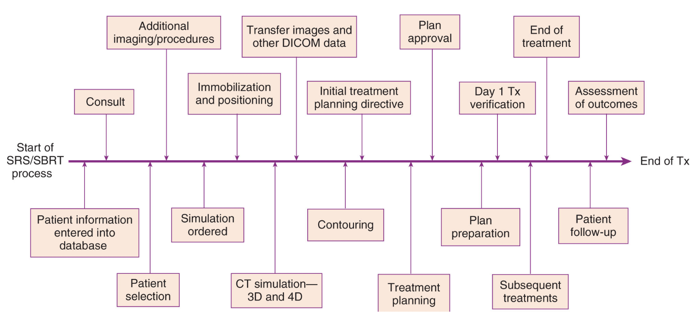

# 2025年度医用画像情報学II（後期）

# 演習問題

問01. 診療情報の 2 次利用にあたるのはどれか。 1.  患者家族への説明 2.  患者本人への診療 3.  院内勉強会での利用 4.  医療従事者間の情報共有 5.  紹介医療機関への情報提供   問02. 診療録等の電子保存の 3 原則に含まれるのはどれか。2 つ選べ。 1.  可用性 2.  完全性 3.  機密性 4.  見読性 5.  真正性   問03. 病院情報システムで正しいのはどれか。 1.  画像情報は放射線情報システムに送信される 2.  X 線撮影の検査オーダには撮影部位の情報が含まれる 3.  医師が行った診察の記録はオーダリングシステムに登録される 4.  検査に用いる医療材料や医薬品は医事会計システムで発注される 5.  実施情報はオーダリングシステムから放射線情報システムに伝達される   問04. 医療情報に関する記載で正しいのはどれか。 1.  IHE は業務ワークフローを定めた標準規格である 2.  MWM は検査実施情報を RIS に伝送する規格である 3.  SSL は画像データの外部保存用統合プロトコルである 4.  ICD-10 はコード体系化された検査プロトコルである 5.  Radiation Dose Structured Report（RDSR）は線量情報を扱う構造化レポートである   問05. DICOM 規格に関係ないのはどれか。 1.  ICD-10 2.  サービスクラス仕様 3.  情報オブジェクト定義 4.  トランスファーシンタックス 5.  コンフォーマンスステートメント   問06. HIS における情報セキュリティ管理の目的で正しいのはどれか。 1.  病院の経営改善 2.  患者診療情報の保護 3.  医薬品安全情報の提供 4.  診療行為の妥当性の担保 5.  放射性廃棄物の適切な処理   問07. DICOM で定義されている医用画像モニタの表示関数はどれか。 1.  GSDF 2.  LUT 3.  MPPS 4.  MWM 5.  ガンマ 2.2   問08. PACS について正しいのはどれか。 1.  画像を検索・参照する機能を持つ 2.  保存した画像は永久保存する義務がある 3.  放射線部門内で発生した画像のみ保管が可能である 4.  RIS と PACS 間の検査オーダ情報の伝達は DICOM 規格で行う 5.  他院から提供された画像データは PACS に保管する義務がある   問09. DICOM 規格について正しいのはどれか。 1.  圧縮画像は扱えない 2.  通信プロトコルは規定されていない 3.  conformance statement（適合性宣言書）が装置に添付される 4.  DICOM 画像ファイルでは先頭から画像データが書き込まれている 5.  DICOM は dose information and communications in medicine の略である   問10. ICD（疾病及び関連保健問題の国際統計分類）で正しいのはどれか。 1.  死因分類は含まれない 2.  国際比較をするための統計分類である 3.  FDA（米国食品医薬品局）が作成した分類である 4.  厚生労働省が発行する人口動態統計には用いられない 5.  疾患が同じであれば部位が異なっても ICD コードは同じである   問11. 診療録等の電子保存の 3 原則の組み合わせで正しいのはどれか。2 つ選べ。 1.  見読性　効率性　認証性 2.  見読性　真正性　認証性 3.  見読性　真正性　保存性 4.  効率性　認証性　保存性 5.  効率性　真正性　保存性   問12. 放射線情報システムの機能に含まれないのはどれか。 1.  照射録の作成 2.  検査の予約管理 3.  患者基本情報の登録 4.  検査の実施情報入力 5.  モダリティとの情報連携   問13. 診療録におけるSOAP 形式記録の項目と記載事項の組合せで正しいのはどれか。2つ選べ。 1.  S 患者の訴え 2.  O 病名 3.  A 検査結果 4.  A 治療計画 5.  P 処方オーダー   問14.  医用画像の特徴として正しいのはどれか。 2つ選べ。 1.  画像圧縮にはアフィン変換が使用される 2.  ウィンドウ幅を大きくするとコントラストが高くなる 3.  2バイト整数型では各画素に から255 の値を割り振る 4.  ウィンドウレベルを変化させるとモニタの輝度が変化する 5.  DICOM 規格は医用画像の閲覧互換性を確保するために用いられる   問15. 遠隔画像診断（テレラジオロジー）について正しいのはどれか。 1.  画像の送信時は患者情報の匿名化を行う 2.  被依頼施設の医師による診察が必要である 3.  被依頼施設は特定機能病院でなければならない 4.  依頼施設と被依頼施設の双方に電子カルテが導入されていなければならない 5.  各施設間はセキュリティ担保のためVPN（Virtual Private Network）回線等で接続する   問16. 症候的情報にあたるのはどれか。 1.  患者の治療計画 2.  患者の自覚的症状 3.  医師の診断に至る思考 4.  治療後の病状推移の予想 5.  患者からの投書に対する回答   問17. 医療情報の一次利用にあたるのはどれか。 1.  医学教育への利用 2.  医学研究への利用 3.  病院経営管理への利用 4.  医療政策の立案・検証への利用 5.  医療行為の公的書類作成のための利用   問18. ネットワークを介して電子カルテシステムと直接連携しないのはどれか。 1.  National Database 2.  健診システム 3.  遠隔医療システム 4.  院外薬局のシステム 5.  地域医療連携システム   問19. 病院情報システムを構成する各システムが、電子保存や情報セキュリティを確保するために持つべき共通基盤となる機能にあたらないのはどれか。 1.  監査証跡 2.  時刻同期 3.  ユーザ情報管理 4.  診療報酬請求機能 5.  ユーザ認証と権限管理   問20. 電子保存の三原則とその対策の組み合わせで正しいのはどれか。 1.  真正性ー情報の所在管理 2.  真正性ー記憶媒体の劣化対策 3.  見読性ーモニタの不変性試験 4.  見読性ーシステム障害対策 5.  保存性ー更新履歴の保存   問21. オーダエントリシステムで入力されたオーダに対し、実施入力が行われないのはどれか。 1.  処置オーダ 2.  注射オーダ 3.  病名オーダ 4.  検体検査オーダ 5.  放射線画像検査オーダ   問22. 診察開始可能となった患者を外来診察室へ呼び込むための患者呼び出しシステムの機能に必須でないのはどれか。 1.  会計完了情報の取得 2.  患者来院状況の把握 3.  調剤完了情報の送信 4.  予約患者一覧の取得 5.  患者案内表示板との連携   問23. RISの機能でないのはどれか。 1.  カテーテルなど高額な検査物品を管理する。 2.  検査画像を確認し修正のうえPACSへ送信する。 3.  放射線管理に係る法令にもとづいた各種記録を管理する。 4.  診療報酬算定に関係する情報を医事会計システムに伝達する。 5.  画像検査オーダを受け、その検査実施スケジュールを管理する。   問24. 遠隔医療システムについて誤っているのはどれか。 1.  遠隔ICUでは患者の様子がわかる映像も利用する。 2.  オンライン診療を実施する医師は研修の受講が必須である。 3.  遠隔病理診断ではバーチャルスライドシステムが使われる。 4.  遠隔画像診断は画像診断専門医がTV会議システムの映像を見て読影する。 5.  モバイルヘルスでは継続したモニタリングとタイムリーな介入が期待される。   問25. 特定健康診査において健診機関が健診結果を電子的に提出する際に求められるのはどれか。 1.  個人識別にマイナンバーを用いる。 2.  心電図波形はMFER形式を用いる。 3.  胸部レントゲン写真はDICOM形式を用いる。 4.  眼底検査はシェーマをJPEG画像で添付する。 5.  検査項目コードにJLAC10に準拠したコードを用いる。   問26. DICOMについて誤っているのはどれか。 1.  画像だけでなく、レポートに関する規格も含まれる。 2.  メーカーの異なる医用画像表示用モニタであっても同じ階調表現ができる。 3.  SOPには、保存、検索/取得、モダリティワークリスト管理、更新確認等の機能が定義されている。 4.  メーカーは、製品ごとにDICOMへの対応範囲や制約について記載した適合性宜言書を公表している。 5.  画像オブジェクトにはタグごとに属性情報が格納されるが、メーカー独自の属性情報は格納できない。   問27. HL7について誤っているのはどれか。 1.  HL7 FHIRはWeb技術を利用する。 2.  HL7 V2.xメッセージはテキストデータである。 3.  HL7 CDAは電子カルテシステムの機能仕様である。 4.  HL7 V3はあらゆる医療情報をRIMに基づき表現する。 5.  HL7 V2.xはオーダ情報や実施情報の伝送に用いられる。   問28. 医療情報の一次利用に該当しないのはどれか。 1.  検査結果の即時確認 2.  薬局での処方指示参照 3.  多職種によるカルテ情報共有 4.  遠隔地の専門医からの診療助言 5.  診療情報管理士によるがん登録   問29. 病院情報システムの構築に利用されるシンクライアントシステムについて誤っているのはどれか。 1.  セキュリティが向上する。 2.  複数画面の端末を利用できる。 3.  患者データを端末に保存できない。 4.  ネットワークの通信量を減らせる。 5.  ネットワークプリンタが利用できない。   問30. PACSの機能はどれか。2つ選べ。 1.  RDSRの保存 2.  照射録の作成 3.  検査画像の共有 4.  使用した造影剤の登録 5.  物流システムへの使用物品情報の送信   問31. 情報システムの導入や更新に影響を与える外部環境要因はどれか。2つ選べ。 1.  情報技術の革新 2.  医療保険制度の動向 3.  施設の建て替え計画 4.  情報部門の人員体制 5.  電子カルテシステムの更新時期   問32. 医療情報システムの運用について正しいのはどれか。 1.  ユーザに管理者権限を付与する。 2.  すべての端末で共通のパスワードを設定する。 3.  サーバにウイルス対策ソフトをインストールする。 4.  リモート保守用のVPN装置の設定を外部業者に一任する。 5.  遠隔地からtelnetで病院端末にアクセスできるようにする。   問33. 標準マスターを利用することによって期待できる効果はどれか。2つ選べ。 1.  マスターの更新が容易になる。 2.  ユーザ管理の労力が軽減される。 3.  他施設とのデータ連携が容易になる。 4.  改ざんされていないことの証明が容易になる。 5.  施設独自の運用に対応したマスターを作成できる。   問34. 電子カルテシステムが導入された医療機関における障害時の紙運用について正しいのはどれか。2つ選べ。 1.  白紙にオーダ内容を手書きして実施部門へ搬送する。 2.  防災訓練等の機会に紙伝票による運用を実行し検証する。 3.  停電などにより病院情報システムが完全停止した際に実施される。 4.  システム復旧後、紙運用された情報は紙のまま保存しなければならない。 5.  ディザスターリカバリーとして予備系システムを準備していれば不要である。   問35. 医療情報のバックアップの3-2-1ルールについて正しいのはどれか。 1.  「1」はクラウドバックアップを指す。 2.  「1」はオフラインバックアップを指す。 3.  「2」は正・副のバックアップを指す。 4.  「3」は3世代のバックアップを指す。 5.  「3」は3種類の媒体によるバックアップを指す。   問36. オンライン診療について正しいのはどれか。2つ選べ。 1.  暗号化通信が要求されている。 2.  医師は研修の受講が必須である。 3.  録画することが推奨されている。 4.  一般のTV会議システムは利用できない。 5.  電子カルテ端末で実施しなければならない。   問37. 地域医療連携システムについて誤っているのはどれか。2つ選べ。 1.  医療機関は患者の同意なく患者情報にアクセスできる。 2.  更新経費などの維持費の問題で事業継続が課題となっている。 3.  医療機関間で患者情報を共有し、医療連携を円滑に行うことができる。 4.  医療機関間の検査や薬剤のコードの相互運用性の確保が課題となっている。 5.  全ての医療機関が同じ病院情報システムを使用していなければならない。   問38. DICOMについて正しいのはどれか。2つ選べ。 1.  画像検査を実施した技師情報を取り扱える。 2.  画像検査に関する注射オーダ情報を取り扱える。 3.  UID（Unique Identifier）が患者を一意に特定する。 4.  放射線治療の照射線量分布図は画像として保管される。 5.  検査番号（Accession Number）が検査オーダ、レポート、画像を結びつける。   問39. 正しい組み合わせはどれか。 1.  DICOMーCSV 2.  CDA R2ーHTML 3.  HL7 FHIRーJSON 4.  HL7 V2メッセージーPDF 5.  HL7-V3メッセージーデリミタ   問40. SS-MIX2標準ストレージに格納しないのはどれか。 1.  食事オーダ 2.  放射線画像 3.  検体検査結果 4.  アレルギー情報 5.  内視鏡検査の実施通知   問41. 医療機関における個人情報保護について正しいのはどれか。 1.  医療機関は個人情報取扱事業者ではない。 2.  国外に個人情報を提供することは禁止されている。 3.  患者からの要求があれば診療録を削除しなければならない。 4.  目的によらず診療情報はオプトアウト方式で第三者提供できる。 5.  要配慮個人情報を患者から明示的な同意なしで取得できる場合がある。   問42. 個人情報の保護に関する法律（令和5年4月施行）における個人情報取扱事業者について正しいのはどれか。 1.  地方公共団体の病院は個人情報取扱事業者に該当しない。 2.  診療情報から仮名加工情報を作成する場合、利用目的は公表しなくてよい。 3.  大学病院が医学研究で診療情報を取り扱う場合、安全管理措置に係る義務が適用される。 4.   1,000人未満の診療情報を漏えいした場合、個人情報保護委員会への報告義務は免除される。 5.  目的外利用または不正取得に該当しない限り、本人からの利用停止の申し出に対応しなくてよい。   問43. 端末がランサムウェアに感染した兆候を確認したシステム利用者が最初にとるべき行動はどれか。 1.  システム管理者に電話して指示を仰ぐ。 2.  業務を続けるため別の部署の端末を借りに行く。 3.  ウイルス対策ソフトのスキャンを手動実行する。 4.  近傍の端末で同じ現象が発生しているか確認する。 5.  端末に接続されているネットワークケーブルを抜く。   問44. 「医療情報システムの安全管理に関するガイドライン」（第5.2版）では、診療等の都度スキャナ等で文書を電子化して保存する場合、対象文書の発生からどのくらいの期間内にスキャンしなければならないとされているか。 1.  3時間 2.  12時間 3.  1～2日 4.  1週間 5.  1ヶ月   問45. 自施設の病院情報システムに蓄積されたデータのみで算出するのが難しい指標はどれか。 1.  逆紹介率 2.  病床稼働率 3.  がん5年生存率 4.  転倒転落発生率 5.  重症度、医療・看護必要度   問46. 医療情報の1次利用にあたるのはどれか。 1.  医薬品の開発 2.  全国がん登録 3.  経営指標値の算出 4.  外来受診患者数の把握 5.  DPCによる請求の根拠   問47. 医療情報の利用者が真正性を確保するためにとる行動として適切でないのはどれか。 1.  確定操作を行い、入力情報に対する責任を明示する 2.  代行入力の場合、入力権限を持つものが最終的に確定操作を行う 3.  認証番号とパスワードなどによってシステムに利用者を認識させる 4.  利用者の認証番号やパスワードを管理し、これを他者に利用させない 5.  離席するときは、次の作業のために端末にログインしたままにしておく   問48. 病院情報システムについて誤っているのはどれか。 1.  電子カルテシステムは診療記録を保管管理する 2.  医事会計システムは診療報酬明細書の作成を行う 3.  オーダエントリシステムは医師の指示を他部門へ送付する 4.  輸血管理システムは他の病院情報システムと独立している 5.  往診先で用いられる携帯端末は病院情報システムの一部である   問49. テレラジオロジーについて誤っているのはどれか。2つマークしなさい。 1.  D to P型の遠隔地料である 2.  画像はDICOM形式で交換することが一般的である 3.  画像診断専門医不足を解消するための一つの手段である 4.  画像診断専門医がTV会議システムの映像を見て読影する 5.  画像データの伝送には気密性の高いネットワークが利用される   問50. 健診システムについて誤っているのはどれか。 1.  検査結果と合わせて検査診断レベルを管理する 2.  過去の検診結果も含めた検診結果報告書を出力する 3.  審査支払機関に対し診療報酬点数に基づいた請求を行う 4.  受検者IDを発行する前に検査オーダ入力する場合がある 5.  検診コース単位(人間ドック。定期検診など)の予約ができる   問51. 自らが利用した医療保険に関連する情報のうち、デジタル庁が提供するマイナポータルで確認できないのはどれか。 1.  薬剤情報 2.  医療費通知情報 3.  健康保険証情報 4.  放射線画像情報 5.  特定健診結果情報   問52. 紙カルテと比較した電子カルテの特徴として誤っているのはどれか。 1.  情報の複製が困難である 2.  運用変更の柔軟性が低い 3.  情報機器や情報端末の導入に労力がかかる 4.  システムの使用方法の習得のために負担が生じる 5.  情報の一覧性がディスプレイの表示能力に制約される   問53. インシデント・アクシデント・レポートシステムについて正しいのはどれか。 1.  重大事故事例のみ登録する 2.  レポートは報告者の実名で院内に公開する 3.  レポートはリスクマネージャ以外も登録する 4.  レポートは一定期間経過後、速やかに抹消する 5.  医療事故を起こした者からのアクセスを制限する機能が必要である   問54. 病院情報システムと連携したクリニカルパスシステムに組み込むべき機能でないのはどれか。 1.  バリアンスを登録する 2.  クリニカルパス画面からオーダを発行する 3.  患者状態に合わせてクリニカルパスを選択する 4.  クリニカルパス画面でオーダの実施状況を把握する 5.  入院時病名に基づいてクリニカルパスを自動的に適用する   問55. 放射線画像検査オーダ情報を受信し、実施手続きを行うのはどれか。2つマークしなさい。 1.  RIS 2.  HIS 3.  PACS 4.  モダリティ 5.  レポートシステム   問56. 放射線治療業務と情報システムについて正しいのはどれか。 1.  放射線治療は原則として1回の照射で完了する 2.  放射線治療部門専用の治療RISが構築される 3.  放射線治療計画の確定入力は診療放射線技師が行う 4.  密封小線源による内部照射装置とPACSとを接続する 5.  放射線治療計画データや照射野の情報はPACSで参照できる   問57. 病院情報システムにおける医療安全管理の評価指標として正しいのはどれか。2つマークしなさい。 1.  医師の診察時間 2.  不適切な処方の頻度 3.  診察報酬請求の返戻件数 4.  看護師の1日あたりの処置数 5.  転記ミスによるインシデント数   問58. カスタマイズ製品からパッケージ製品を用いた情報システムへの再構築について適切でないのはどれか。2つマークしなさい。 1.  業務運用は極力パッケージに合わせる 2.  異なるメーカーへの再構築であってもデータ移行は容易である 3.  現行の業務運用に対するパッケージ製品のFit&Gap分析を行う 4.  業務継続性を担保するため要求仕様書に「現行踏襲」と明記する 5.  計画段階でユーザ部門が標準機能によるプロトタイプを実機で確認することが望ましい   問59. 保健医療情報分野の標準規格(厚生労働省標準規格)に採用されていないのはどれか。 1.  SS-MIX2 2.  HL7 FHIR 3.  IHE-ITI RFD 4.  SNOMED-CT 5.  ISO 22077-1;2015(MFER)   問60. DICOMにより定義されていないのはどれか。 1.  画像表示機器の輝度特性 2.  放射線読影レポートの記録方法 3.  放射線検査の被ばく線量の記録方法 4.  人工知能によるCADの結果記録方法 5.  VNA(Vendor Neutral Archive)の構築方法   問61. SS-MIX2について誤っているのはどれか。 1.  薬剤コードはYJコードで保存される 2.  検査結果はJLAC10コードで保存される 3.  検査結果は更新前のデータも保存されている 4.  退院時サマリーは作成日のフォルダーに保存される 5.  HL7メッセージのファイル名に診療科コードが含まれる   問62. 診療情報の1次利用にあたるのはどれか。2つ選べ。 1.  裁判所の命令による情報提供 2.  経営のための統計資料の作成 3.  法令で定められた感染症の保健所への報告 4.  検査部門で発生した検査データの診断への活用 5.  審査支払機関への診療報酬明細書のよる医療費請求   問63. 医療情報倫理について誤っているのはどれか。 1.  臨床実習を行う学生にも適用される。 2.  人そのものに対する倫理規範と同質である。 3.  医療倫理に情報倫理を付加したものである。 4.  電子カルテにより行いうる意思決定に関連する。 5.  患者個人を記述する情報の集合に対する規範である。   問64. 健康診断に用いられるシステムの特徴はどれか。 1.  PACSと連動する。 2.  診断結果のレベル分けを行う。 3.  複数の検査を一括して予約する。 4.  過去の検査結果を合わせて表示する。 5.  各種オーダーを発行する前にIDを決定する。   問65. 地域医療連携におけるIHEで関連がない組み合わせはどれか。 1.  時刻サーバーCT 2.  名寄せサーバーPIX 3.  利用者認証サーバーATNA 4.  SS-MIX2サーバーXDS 5.  DICOMサーバーXDS-1   問66. 患者情報を使用しないのはどれか。 1.  重症系システム 2.  手術部門システム 3.  物流管理システム 4.  生理機能検査業務支援システム 5.  医用画像管理システム(PACS)   問67. JAHISの基本データセットで、薬剤アレルギー情報に含まれないのはどれか。 1.  症状 2.  病名 3.  発現日 4.  情報提供者 5.  アレルゲン名称   問68. オーダーエントリシステムについて誤っているのはどれか。 1.  利用者認証の機能が実装されている。 2.  診療報酬明細書を発行するシステムである。 3.  医師は行為の承認、結果の確認などを行う。 4.  医師の指示を医療スタッフに伝えるシステムである。 5.  入力される情報は診療報酬請求に必要な内容を含んでいる。   問69. 予約機能が必要なシステムはどれか。2つ選べ。 1.  外来受付システム 2.  病名登録システム 3.  病理検査システム 4.  処方オーダシステム 5.  放射線検査システム   問70. 令和2年4月から施行された医療法施行規則の被曝線量管理について誤っているのはどれか。 1.  透視装置では線量計の情報を用いることもある。 2.  CTの場合、DICOM-RDSRに患者被曝線量が記載されている。 3.  DICOM-RDSRに対応していない場合にはDICOM-MPPSを用いる。 4.  患者毎の被曝線量を管理し、患者個人の被曝線量を減らすことが目的である。 5.  患者毎の被曝線量を管理し、プロトコール毎の被曝線量を減らすことが目的である。   問71. 診療情報管理部門システムに求められる機能でないのはどれか。 1.  がん登録支援 2.  DPCコーディング支援 3.  診療報酬明細書作成支援 4.  紙の診療録のアリバイ管理・貸出管理 5.  患者基本情報と退院時要約情報の収集、点検   問72. 医療機関におけるDWHの機能はどれか。2つ選べ。 1.  データの漏洩を防止する。 2.  入力データを自動的に標準化できる。 3.  研究対象となる症例候補を検索できる。 4.  入力途中のデータを判別して自動で抽出できる。 5.  症例の基本データセットを統計解析用に出力できる。   問73. IHEについて誤っているのはどれか。 1.  統合プロファイル内の各機能を提供する「アクタ」同士の通信をトランザクションと呼ぶ。 2.  地域医療連携における情報連携基盤技術仕様はさまざまな統合プロファイルを含んでいる。 3.  システム導入時にIHEを参考にすることで、システム構成の選択肢が増えることが期待できる。 4.  システム連携を実現するための標準規格の使い方を示したガイドラインを統合プロファイルと呼ぶ。 5.  システムや機器同士の接続試験を行うコネクタソンを開催し、接続性のとれたシステムや機器を認定する。   問74. 他院から提供された画像CDのデータを取り込みできない場合、原因から除外できるのはどれか。 1.  提供された媒体に傷がある。 2.  患者IDが自院のIDと異なっている。 3.  過去に取り込み済みの画像が含まれている。 4.  IHE-PDI規格以外の形式で保存されている。 5.  DICOMに含まれない特殊なファイル形式の画像が含まれている。   問75. 放射線部門システムについて誤っているのはどれか。 1.  放射線画像検査種のコードにJJ1017がある。 2.  モダリティに患者情報をJLAC10で伝達する。 3.  モダリティから検査進捗情報をDICOMで受け取る。 4.  検査ごとの照射線量をDICOMでPACSに保存可能である。 5.  オーダエントリシステムからオーダ情報をHL7で受け取る。   問76. 標準規格とその内容の説明の組み合わせのうち正しいのはどれか。 1.  SNOMED-CTー国際的な医療用語集 2.  CDAー臨床試験データの標準規格 3.  CDISCー臨床文書の構造に関する規格 4.  LOINCー看護実践を記述する標準用語集 5.  ICNPー検体検査や生理機能検査を表現するコードセット   問77. 病院情報システムの「真正性」確保に直接関連するのはどれか。2つ選べ。 1.  IDと指紋で利用者認証を行う。 2.  外部保存の管理を第三者に委ねる。 3.  いつでも診療データが確認できるようにする。 4.  データの自動バックアップシステムを用意する。 5.  データ保存時に自動的にタイムスタンプを付ける。   問78. HPKIで確認できるのはどれか。 1.  患者属性 2.  保険者の種類 3.  医療機関の種別 4.  医療従事者の資格 5.  所属医療機関の名称   問79. Quality Managementの記載で誤っているのはどれか。 1.  リスク分析を導入することは、品質マネジメントを冗長で非効率にする 2.  プロセスマップとは、すべての業務のプロセスを可視化し、職種ごとの作業内容・連携・流れを模式図で表したものである 3.  故障モード影響解析（FMEA）とは、事象における発生頻度、影響度、検出難易度を定量評価する方法である 4.  様々な視点で高リスク事象を特定するためにもリスク分析を主としたチームを作り多くの職種が参画することが重要である 5.  PDCA（Plan-Do-Check-Action）のサイクルに基づいて行うことが、実効性を高める   問80. 次の図を表しているのは次のうちどれか。 {width=7cm} 1.  プロセスマップ 2.  放射線治療計画 3.  クリニカルパス 4.  PDCAサイクル 5.  nan   問81. Quality Managementの記載で誤っているのはどれか。 1.  リスク分析を導入することで効率的かつ効果的に品質マネジメントが実施できる 2.  プロセスマップとは、全行程を最短時間で完了するために重要な作業経路のことである 3.  故障モード影響解析（FMEA）とは、事象における発生頻度、影響度、検出難易度を定量評価する方法である 4.  様々な視点で高リスク事象を特定するためにもリスク分析を主としたチームを作り多くの職種が参画することが重要である 5.  PDCA（Plan-Do-Check-Action）のサイクルに基づいて行うことが、実効性を高める   問82. Quality Managementの記載で誤っているのはどれか。 1.  リスク分析を導入することで効率的かつ効果的に品質マネジメントが実施できる 2.  プロセスマップとは、すべての業務のプロセスを可視化し、職種ごとの作業内容・連携・流れを模式図で表したものである 3.  故障モード影響解析（FMEA）は、ハインリッヒの法則に従う方法である 4.  様々な視点で高リスク事象を特定するためにもリスク分析を主としたチームを作り多くの職種が参画することが重要である 5.  PDCA（Plan-Do-Check-Action）のサイクルに基づいて行うことが、実効性を高める   問83. Quality Managementの記載で誤っているのはどれか。 1.  リスク分析を導入することで効率的かつ効果的に品質マネジメントが実施できる 2.  プロセスマップとは、すべての業務のプロセスを可視化し、職種ごとの作業内容・連携・流れを模式図で表したものである 3.  故障モード影響解析（FMEA）とは、事象における発生頻度、影響度、検出難易度を定量評価する方法である 4.  高リスク事象を特定するために、リスク分析は単独職種で行う 5.  PDCA（Plan-Do-Check-Action）のサイクルに基づいて行うことが、実効性を高める   問84. Quality Managementの記載で誤っているのはどれか。 1.  リスク分析を導入することで効率的かつ効果的に品質マネジメントが実施できる 2.  プロセスマップとは、すべての業務のプロセスを可視化し、職種ごとの作業内容・連携・流れを模式図で表したものである 3.  故障モード影響解析（FMEA）とは、事象における発生頻度、影響度、検出難易度を定量評価する方法である 4.  様々な視点で高リスク事象を特定するためにもリスク分析を主としたチームを作り多くの職種が参画することが重要である 5.  SOAP（Subject-Object-Assessment-Plan）のサイクルに基づいて行うことが、実効性を高める   問85. 病院情報システムの安全管理措置で\underline{誤っている}のはどれか。 1.  安全管理に関する手順書を整備する。 2.  個人の記録媒体の使用を可能とする。 3.  利用者に守秘義務に関する訓練を行う。 4.  不正なソフトウェアの混入防止対策を行う。 5.  情報区分と利用者とを対応付けしたアクセス制限を設定する。   問86. HIS における情報セキュリティ管理の目的で正しいのはどれか。 1.  医療情報の標準化 2.  医療情報の相互接続 3.  患者診療情報の保護 4.  医用デジタル画像の通信 5.  マルチモダリティ間の画像データ転送   問87. 診療録作成、検査予約の管理、会計情報の入力などの機能を有するシステムはどれか。 1.  RIS 2.  HL7 3.  CAD 4.  PACS 5.  DICOM   問88. WHO1が制定する国際疫病分類はどれか。 1.  DPCコード 2.  ICDコード 3.  IHEコード 4.  JANコード 5.  JJ1017コード   問89. 病院情報システム＜HIS＞導入の目的でないのはどれか。 1.  業務の効率化 2.  情報の共有化 3.  病院経営の支援 4.  患者サービスの向上 5.  情報漏えいのリスク低下   問90. IHEの説明で正しいのはどれか。 1.  国際的な疾病の分類 2.  医用画像の保存と通信の標準規約 3.  文字や数字などの診療情報交換のための標準規格 4.  医用画像表示モニタの品質管理に関するガイドライン 5.  医療情報システムの相互接続性を推進するプロジェクト   問91. PACSで誤っているのはどれか． 1.  画像を検索・参照する機能を持つ． 2.  保存した画像は永久保存する義務がある． 3.  導入により手間やコストの削減が期待される 4.  放射線部内で発生した画像以外も保管が可能である． 5.  他院から提供された画像データはPACSに保管する義務はない．   問92. 正しいのはどれか．2つ選べ． 1.  PACSは物流管理システムである． 2.  HL7は医用画像交換の標準規格である． 3.  ICD-10はコード体系化された薬品名で
ある． 4.  IHEのPDIは画像データの外部保存用統
合プロファイルである． 5.  MWMサービスはオーダ情報の医療機
器への伝達標準規格である．   