# 2025年度医用画像情報学II（後期）

# 演習問題

問01. 集合A, Bからなるベン図で斜線部分を表すのはどれか。 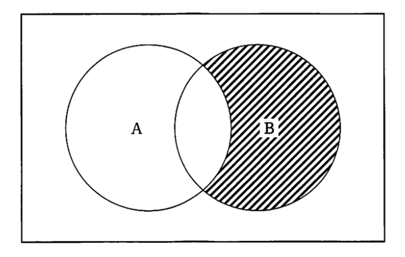{width=7cm} 1.  NOT A 2.  A XOR B 3.  A NAND B 4.  NOT(A XOR B) 5.  (NOT A) AND B   問02. 1,024 × 2,048 画素、階調数 16 bit の DICOM 画像のデータ量 [MB] に最も近いのはどれか。ただし、ヘッダ情報は含まないものとする。 1.  2 2.  4 3.  8 4.  16 5.  32   問03. 情報の数の表現で正しいのはどれか。 1.  1 Gbit は 1,024 Mbyte である 2.  1 byte は 10 進数の 8 桁分である 3.  16 進法は 0 から 15 までの整数で表す 4.  アスキーコードは数値データの表現形式である 5.  2 byte の符号なし整数型は 0 から 65,535 の値を表現できる   問04. ファイアウォールの機能で正しいのはどれか。 1.  ログイン時にパスワードを要求する 2.  通信パケットに含まれるウイルスを駆除する 3.  ネットワーク間で暗号化された通信だけを許可する 4.  脆弱性があるシステムのソフトウェアを自動更新する 5.  外部と内部のネットワーク間で特定の通信だけを許可する   問05. 16進数の「25」と2進数の「1010101」の和を2進数で表したのはどれか。 1.  1011111 2.  1101010 3.  1101110 4.  1111010 5.  1111110   問06. 1 ピクセルが 100 $\mu$ m の FPD で撮影した胸部 X 線画像のデータ量 [MB] に最も近いのはどれか。ただし、FPD の有効視野は 43 cm × 43 cm、階調数は 16 bit とする。 1.  2 2.  16 3.  37 4.  148 5.  296   問07. 画像のデジタル化について正しいのはどれか。 1.  量子化を行ったあとに標本化を行う 2.  ナイキスト周波数は標本化周波数の 2 倍である 3.  標本化定理により適切な量子化ビット数を決める 4.  量子化ビット数を増やすと量子化誤差は大きくなる 5.  最高周波数が 10 cycles/mm のアナログ画像を 0.1 mm 間隔で標本化するとエリアシング誤差を生じる   問08. 図に示す回路を表す演算はどれか。 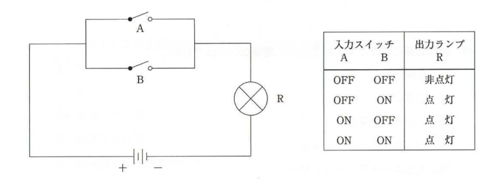{width=7cm} 1.  論理積演算 2.  論理和演算 3.  否定論理積演算 4.  否定論理和演算 5.  排他的論理和演算   問09. 16 進数の 2A を 2 進数で表したのはどれか。 1.  0010 1100 2.  0010 1010 3.  0010 1011 4.  0011 1011 5.  0011 1110   問10. コンピュータの基本構成を図に示す。a-cに入る装置の組み合わせで正しいのはどれか。 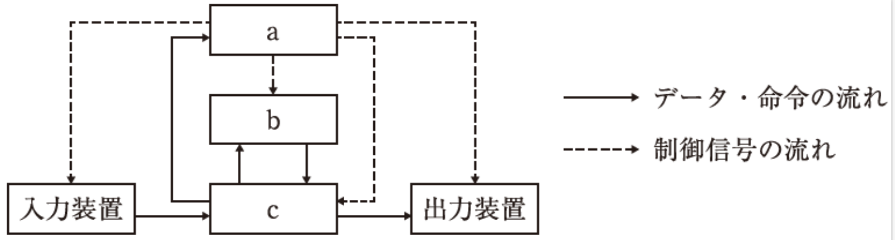{width=7cm} 1.  a演算装置 b記憶装置 c制御装置 2.  a記憶装置 b演算装置 c制御装置 3.  a記憶装置 b制御装置 c演算装置 4.  a制御装置 b演算装置 c記憶装置 5.  a制御装置 b記憶装置 c演算装置   問11. 論理演算表を図に示す。論理回路で正しいのはどれか。 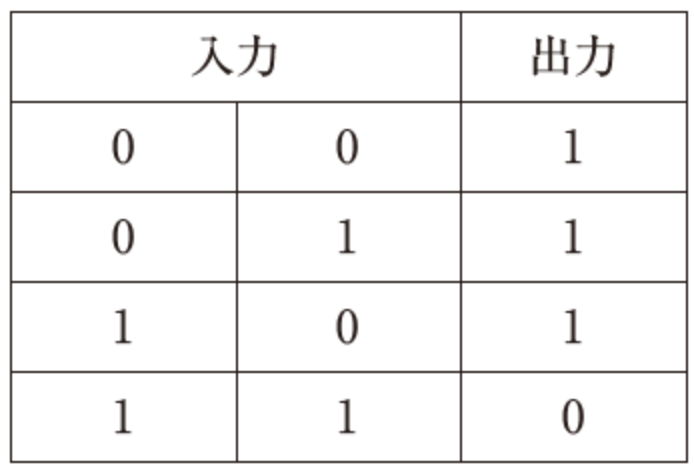{width=7cm} 1.  NAND 2.  NOR 3.  否定 4.  論理積 5.  論理和   問12. 医用画像について正しいのはどれか。 1.  標本化は画像の空間分解能に影響しない 2.  8bit で量子化された画像の階調数は1,024 である 3.  CAD とはコンピュータによる自動確定診断システムである 4.  DICOM 画像はオブジェクト指向モデルに基づいて情報が定義されている 5.  画素間隔0.1 mmで標本化された画像のナイキスト周波数は2cycles/mmである   問13. マトリクスサイズ2,048x2,048で1,024階調のRAWの画像の画像ファイル容量[MB]はどれか。ただし、ヘッダ情報は含まないものとする。 1.  4 2.  8 3.  20 4.  40 5.  60   問14. 10進法の 12.4 を 2進法に変換した値はどれか。ただし小数点は第4位まで表示されたものとする。 1.  1010. 0011 2.  1010. 0110 3.  1100. 0110 4.  1100. 1001 5.  1110. 0011   問15. コンピュータソフトウェアにおけるオペレーティングシステム（OS）の機能はどれか。 1.  リスク分析 2.  知的財産権の管理 3.  プロジェクト管理 4.  データベースシステムの管理 5.  ユーザインターフェースの提供   問16. 8cycles/mmの正弦波を0.1 mm間隔で標本化したデジタルデータから再現される正弦波の空間周波数(cycles/mm)はどれか。 1.  0 2.  2 3.  3 4.  5 5.  10   問17.  16進数の「36」と2進数の「1010101」の足し算の結果を2進数で表したのはどれか。
 1.   10001010
 2.   10001011
 3.   10011001
 4.   11011010
 5.   11011011
   問18.  10進数の「31」を2進数で表したのはどれか。
 1.   10000
 2.   11101
 3.   11110
 4.   11111
 5.   100000
   問19.  16進数の「1F」を2進数で表したのはどれか。
 1.   00000111
 2.   00001111
 3.   00011111
 4.   00111111
 5.   01111111
   問20.  2進数の11100011を16進数で表したのはどれか。
 1.   3E
 2.   73
 3.   74
 4.   D3
 5.   E3
   問21.  2進数の01111と00101の足し算はどれか。
 1.   01111
 2.   10000
 3.   10010
 4.   10100
 5.   11111
   問22.  16進数の「58」と「47」の足し算の結果を2進数で表したのはどれか。
 1.   01010011
 2.   01010111
 3.   01101001
 4.   10001111
 5.   10011111
   問23.  16進数の「36」と「25」の足し算の結果を2進数で表したのはどれか。
 1.   00111101
 2.   01011011
 3.   01101011
 4.   10101001
 5.   10110110
   問24.  16進数の「A0」と「5F」の足し算の結果を16進数で表したのはどれか。
 1.   41
 2.   AF
 3.   F0
 4.   FE
 5.   FF
   問25.  2進数の1101と1100の論理積の結果はどれか。
 1.   0001
 2.   0010
 3.   0110
 4.   1100
 5.   1101
   問26.  2進数10000110と00101101の各桁の論理和（OR）を16進数で表したのはどれか。
 1.   04
 2.   73
 3.   A7
 4.   AF
 5.   BF
   問27.  2進数1110と1011の各桁の排他的論理和（XOR）はどれか。
 1.   0011
 2.   0101
 3.   1010
 4.   1100
 5.   1111
   問28.  表の結果が得られる演算はどれか。
 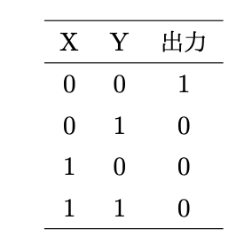{width=7cm} 1.   X OR Y
 2.   X AND Y
 3.   NOT (X OR Y)
 4.   NOT (X AND Y)
 5.   (NOT X) AND Y
   問29.  X = 1、Y = 0 の場合、次の演算のうち演算結果が0になるのはどれか。
 1.   X AND $\rm\bar{Y}$
 2.   X NAND Y
 3.   X NOR Y
 4.   X OR Y
 5.   X XOR Y
   問30.  AとBの論理演算について正しいのはどれか。
 1.   A=0, B=1の場合、NANDの結果は0
 2.   A=0, B=1の場合、XORの結果は0
 3.   A=1, B=0の場合、ORの結果は0
 4.   A=1, B=0の場合、XORの結果は0
 5.   A=1, B=1の場合、NANDの結果は0
   問31.  データ長が可変である文字コードはどれか。
 1.   ASCII
 2.   EUC
 3.   ISO-2022-JP
 4.   Shift-JIS
 5.   UTF-8
   問32.  単一の文字コード体系で多言語文字を取り扱うための規格はどれか。
 1.   EUC
 2.   ASCII
 3.   Unicode
 4.   JIS2004
 5.   Shift-JIS
   問33.  文字符号化形式であるUTF-8について正しい記述はどれか。
 1.   機種依存文字である。
 2.   バイト長が固定である。
 3.   JISで規格化されている。
 4.   表示にはコンパイルが必要である。
 5.   Unicodeで使える文字コードである。
   問34.  漢字を\underline{扱えない}文字コードはどれか。
 1.   EUC-JP
 2.   ISO-2022-JP
 3.   JIS X 0201
 4.   JIS X 0208
 5.   UTF-8
   問35.  7ビットの文字コードはどれか。
 1.   ASCII
 2.   EBCDIC
 3.   EUC
 4.   Shift JIS
 5.   UTF-8
   問36.  情報の単位の接頭辞のT（テラ）の表現として正しいのはどれか。
 1.   10の　３乗
 2.   10の　６乗
 3.   10の　９乗
 4.   10の　１２乗
 5.   10の　１５乗
   問37.  単位の接頭語が大きい順に並んでいるのはどれか。
 1.   G $>$ T $>$ M $>$ k
 2.   k $>$ M $>$ G $>$ T
 3.   M $>$ G $>$ T $>$ k
 4.   T $>$ G $>$ k $>$ M
 5.   T $>$ G $>$ M $>$ k
   問38.  単位の接頭語が大きい順に並んでいるのはどれか。
 1.   m $>$ $\mu$ $>$ p $>$ n
 2.   m $>$ $\mu$ $>$ n $>$ p
 3.   m $>$ p $>$ $\mu$ $>$ n
 4.   $\mu$ $>$ m $>$ p $>$ n
 5.   $\mu$ $>$ m $>$ n $>$ p
   問39.  10の12乗の接頭語はどれか。
 1.   G（ギガ）
 2.   k（キロ）
 3.   M（メガ）
 4.   P（ペタ）
 5.   T（テラ）
   問40.  データ型がshort（16 bit）でpixel数が縦横ともに512のCT画像\underline{10枚}のデータサイズで一番近いものはどれか。
 1.   5.1 kByte
 2.   0.3 MByte
 3.   1.3 MByte
 4.   5.2 MByte
 5.   41.9 MByte
   問41.  画像データの解像度を表す単位はどれか。
 1.   avi
 2.   bps
 3.   pixel
 4.   FLOPS
 5.   rpm
   問42.  中央処理装置に含まれるのはどれか。
 1.   出力装置
 2.   制御装置
 3.   通信装置
 4.   入力装置
 5.   主記憶装置
   問43.  CPU内部での命令の処理手順について正しいのはどれか。
 1.   解読ー実行ー取得ー出力
 2.   解読ー取得ー出力ー実行
 3.   取得ー解読ー実行ー出力
 4.   取得ー解読ー出力ー実行
 5.   実行ー取得ー解読ー出力
   問44.  入力装置が扱う情報の組み合わせで誤っているのはどれか。
 1.   マウス　　　　　　—　位置
 2.   キーボード　　　　—　文字
 3.   マイクロフォン　　—　動画像
 4.   スキャナ　　　　　—　静止画像
 5.   バーコードリーダ　—　コード
   問45.  コンピュータの構成要素について正しいのはどれか。
 1.   スキャナには文字判別機能がある
 2.   ディスプレイのサイズは、解像度と比例している
 3.   メインメモリには、実行中のプログラムが保存される
 4.   デュアルコアCPUは、処理の二重化により信頼性を高めている
 5.   パーソナルコンピューター用の主なCPUでは、制御装置と演算装置とを独立に取り替えられる
   問46.  補助記憶装置はどれか。
 1.   タッチパッド
 2.   ディスプレイ
 3.   メインメモリ
 4.   ハードディスク
 5.   キャッシュメモリ
   問47.  補助記憶装置について正しいのはどれか。
 1.   DVD-ROM：ディスク表面の磁性体に情報を記録する。
 2.   HDD：ディスクに刻んだ凹凸で情報を記録する。
 3.   SDメモリーカード：赤外線を使って情報を記録する。
 4.   SSD：レーザ光を使って記録する。
 5.   USBメモリ：ROM型の半導体メモリに記録する。
   問48.  補助記憶装置について\underline{誤っている}のはどれか。
 1.   BD-R：レーザー光を使って記憶を行なう
 2.   HDD：ディスク表面の磁性体に情報を記録する
 3.   SDメモリカード：赤外線を使って情報を記録する
 4.   USBメモリ：ROM型の半導体メモリが使われている
 5.   DVD-ROM：ディスクに刻んだ凹凸で情報を表現する
   問49.  メモリに関する説明文のうち、\underline{誤っている}のはどれか。
 1.   SRAM:リフレッシュの必要がない
 2.   USBメモリ：書き込み回数に制限がある
 3.   DRAM：定期的な再書き込みが必要である
 4.   マスクROM：製造時の内容が変更できない
 5.   フラッシュメモリ：利用者は内容を変更できない
   問50.  Blu-rayディスクの読み取りに用いるのはどれか。
 1.   磁気
 2.   赤外線
 3.   放射線
 4.   レーザー光
 5.   マイクロ波
   問51.  光によりデータを読み書きする記録メディアはどれか。
 1.   SSD
 2.   ハードディスク
 3.   SDメモリカード
 4.   Blu-rayディスク
 5.   フロッピーディスク
   問52.  SSDについて\underline{誤っている}のはどれか。
 1.   衝撃に強い。
 2.   読み取り速度が速い。
 3.   HDDに比べ軽量である。
 4.   書き換え回数に制限がある。
 5.   磁気ディスクに記録している。
   問53.  消去や書き換えが可能なメディアはどれか。
 1.   BD-R
 2.   BD-RE
 3.   CD-ROM
 4.   DVD-R
 5.   DVD-ROM
   問54.  メモリについて\underline{誤っている}のはどれか。
 1.   マスクROMは書き換え不可である。
 2.   SRAMはリフレッシュが不要である。
 3.   DRAMはリフレッシュが必要である。
 4.   EPROMは赤外線でデータを消去する。
 5.   EEPROMは電圧をかけてデータを消去する。
   問55.  仮想記憶について正しいのはどれか。
 1.   不揮発性である。
 2.   処理速度が改善する。
 3.   専用の補助記憶装置を使用する。
 4.   物理的な主記憶装置が不要になる。
 5.   主記憶装置の容量の不足時に使う。
   問56.  バックライトを必要とするのはどれか。
 1.   液晶ディスプレイ
 2.   CRTディスプレイ
 3.   LEDディスプレイ
 4.   プラズマディスプレイ
 5.   有機ELディスプレイ
   問57.  スキャナの解像度を表す単位はどれか。
 1.   bps
 2.   dpi
 3.   ppm
 4.   rpm
 5.   pixel
   問58.  紙に印刷された文字などを認識し、コンピュータ上の文字データへ変換する装置はどれか。
 1.   OCR
 2.   OMR
 3.   タッチパネル
 4.   バーコードリーダ
 5.   ICカードリーダ
   問59.  移動方向と距離とを検出する入力装置はどれか。
 1.   OCR
 2.   OMR
 3.   キーボード
 4.   タッチパッド
 5.   イメージスキャナ
   問60.  シート上の塗りつぶしたマークを読み取る装置はどれか。
 1.   OMR
 2.   PDA
 3.   キーボード
 4.   タッチパネル
 5.   ドットインパクトプリンタ
   問61.  複写式の伝票に印字が可能なプリンタはどれか。
 1.   感熱式プリンタ
 2.   熱転写式プリンタ
 3.   レーザープリンタ
 4.   インクジェットプリンタ
 5.   ドットインパクトプリンタ
   問62.  USB3.0の理論上の最大データ転送速度はどれか。
 1.   1.5 Mbps
 2.   12 Mbps
 3.   480 Mbps
 4.   5 Gbps
 5.   10 Gbps
   問63.  パソコンとプロジェクタをデジタル接続するために用いるコネクタはどれか。
 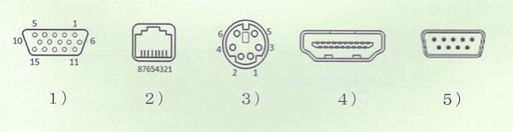{width=7cm} 1.   1)
 2.   2)
 3.   3)
 4.   4)
 5.   5)
   問64.  記録面の物理的な凹凸によってデータを記録するのはどれか。
 1.   BD-RE
 2.   CD-ROM
 3.   HDD
 4.   SDカード
 5.   USBメモリ
   問65.  補助記録装置を使って主記憶装置の容量以上のメモリ領域を割り当てる機能はどれか。
 1.   仮想記憶
 2.   入出力管理
 3.   ユーザー管理
 4.   プロセス管理
 5.   周辺装置の制御
   問66.  プロジェクターとノートパソコンをアナログ接続するために用いるコネクタはどれか。
 1.   Display port
 2.   D-Sub15
 3.   HDMI
 4.   RJ-45
 5.   USB
   問67.  パソコンとディスプレイをデジタル接続するために用いるコネクタはどれか。
 1.   RS-232C
 2.   PS/2
 3.   HDMI
 4.   DSub15
 5.   RJ-45
   問68.  ディスプレイとデジタル接続するためのインターフェースはどれか。
 1.   IDE
 2.   PS/2
 3.   eSATA
 4.   DVI-I
 5.   RS-232C
   問69.  次のうちシリアルインターフェイス\underline{でない}のどれか。
 1.   IDE
 2.   IEEE1394
 3.   RS-232C
 4.   SATA
 5.   USB
   問70.  複数台のハードディスクを組み合わせ、図に示すようなデータの記録を行う方式はどれか。 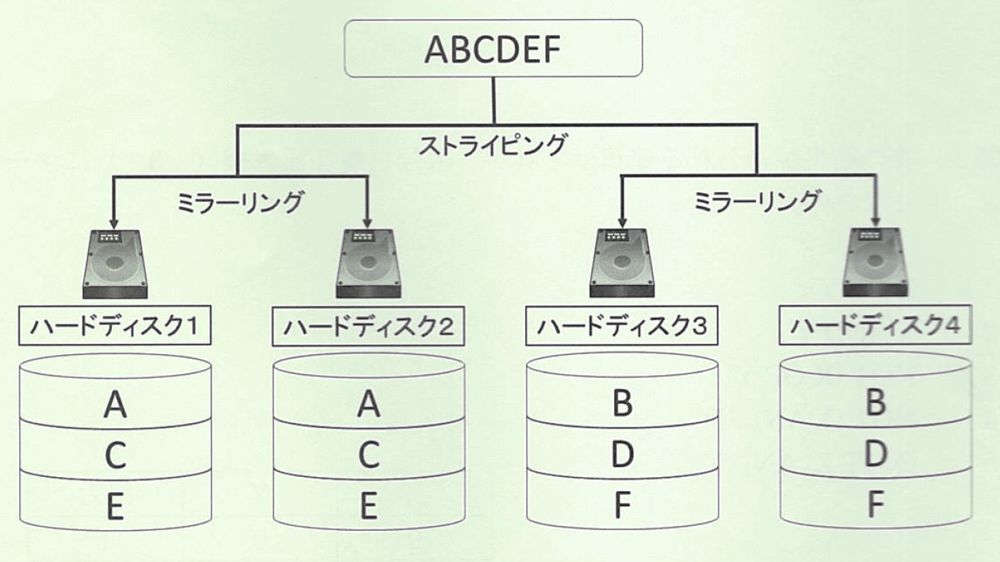{width=7cm} 1.   RAID 0
 2.   RAID 1
 3.   RAID 5
 4.   RAID 6
 5.   RAID 10
   問71.  RAIDについて正しいのはどれか。
 1.   RAID１はストライピングとも呼ばれる
 2.   RAID１はパリティをミラーリングする
 3.   RAID５はディスク２台から構成できる
 4.   RAID０は1台のディスクが故障しても修復できる
 5.   RAID５はパリティを複数のディスクにストライピングする
   問72.  RAID1について正しいのはどれか。
 1.   構成に必要な最低台数は３台である。
 2.   データを分割して複数のハードディスクに書き込む。
 3.   同じ内容のデータを複数のハードディスクに書き込む。
 4.   使用可能容量は構成台数から２台分ひいたものになる。
 5.   同時に２台以上のハードディスクが故障するとデータを回復できない。
   問73.  RAID1について正しいのはどれか。
 1.   ストライピングと呼ばれる。
 2.   パリティを追加して書き込む。
 3.   データの読み書き速度が向上する。
 4.   同じデータを複数のハードディスクに記録する。
 5.   最小構成に必要なハードディスクの数は3台である。
   問74.  RAID5の説明のうち正しいのはどれか。
 1.   構成に必要な最低台数は4台である。
 2.   同じ内容のデータを複数のハードディスクに書き込む。
 3.   使用可能容量は構成台数から2台分をひいたものとなる。
 4.   1台のハードディスクが故障してもデータの回復ができる。
 5.   パリティの保存に使われるハードディスクが決まっている。
   問75.  1台2TBのディスク装置4台でRAID5を構成した場合の実効容量はどれか。
 1.   2TB
 2.   4TB
 3.   6TB
 4.   8TB
 5.   10TB
   問76.  1台500GBのハードディスクを用いて有効容量が2TBのRAID5のディスクアレイを構築する場合の必要なハードディスクの数はいくつか。
 1.   4
 2.   5
 3.   6
 4.   8
 5.   10
   問77.  1台500GBのハードディスク5台を用いてRAID5を構築する場合の実効容量はいくらか。
 1.   1TB
 2.   1.25TB
 3.   1.67TB
 4.   2TB
 5.   2.5TB
   問78.  複数台のハードディスクを組み合わせ、図のようなデータの記録を行う方式はどれか。
 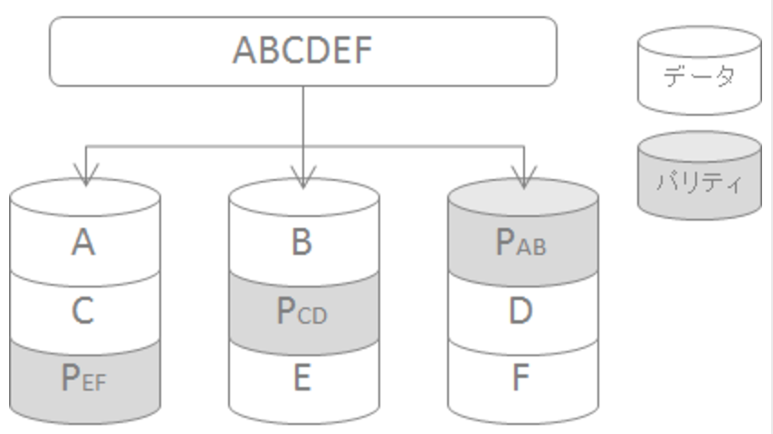{width=7cm} 1.   RAID0
 2.   RAID1
 3.   RAID5
 4.   RAID6
 5.   RAID10
   問79. 「ABCDEF」というデータを図に示すように4台のハードディスク・ドライブに記録する方式はどれか。
 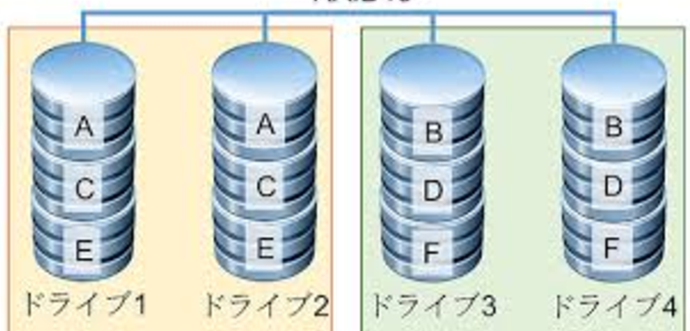{width=7cm} 1.   RAID0
 2.   RAID1
 3.   RAID5
 4.   RAID6
 5.   RAID10
   問80. 「ABCDEF」というデータを図に示すように4台のハードディスク・ドライブに記録する方式はどれか。
 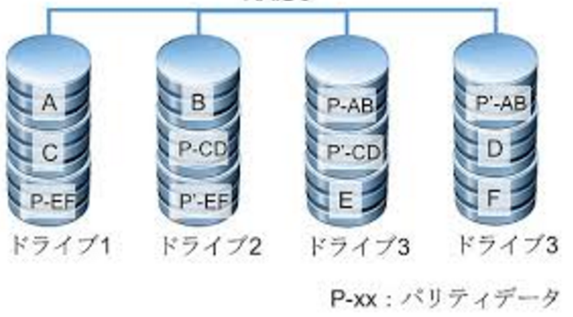{width=7cm} 1.   RAID0
 2.   RAID1
 3.   RAID5
 4.   RAID6
 5.   RAID10
   問81.  オペレーレーディングシステムの機能に\underline{含まれない}のはどれか。
 1.  タスク制御
 2.  メール管理
 3.  メモリ管理
 4.  ユーザ管理
 5.  周辺装置の制御
   問82.  DBMS（データベース管理システム）はどれに分類されるか。
 1.   BIOS
 2.   ミドルウェア
 3.   ファームウェア
 4.   デバイスドライバ
 5.   オペレーティングシステム
   問83.  \underline{コンパイラ言語ではない}のはどれか。
 1.   C
 2.   C++
 3.   COBOL
 4.   Java
 5.   R
   問84.  プログラミング言語で記述されたソースプログラムをコンピュータが実行可能な形式に変換する操作はどれか。
 1.   デバッグ
 2.   コンパイル
 3.   ハッキング
 4.   マイニング
 5.   リバースエンジニアリング
   問85.  オペレーティングシステムの機能に\underline{含まれない}のはどれか。
 1.   メモリ管理
 2.   プロセス管理(タスク管理)
 3.   データベースシステムの管理
 4.   言語(日本語)環境のサポート
 5.   ユーザインターフェースの提供
   問86.  PC(パーソナルコンピュータ)のファームウェアに相当するのはどれか。
 1.   BIOS
 2.   Webサーバ
 3.   ワープロソフト
 4.   デバイスドライバ
 5.   リカバリーソフト
   問87.  ハードウェアの基本的な制御を行うために機器に組み込まれたソフトウェアを何というか。
 1.   マルウェア
 2.   シェアウェア
 3.   ミドルウェア
 4.   グループウェア
 5.   ファームウェア
   問88.  静止画像フォーマットであるJPEGについて正しいのはどれか。
 1.   256色の可逆圧縮方式である
 2.   2値画像の再現性に特化している
 3.   離散コサイン変換とハフマン符号化を用いた非可逆圧縮方式である
 4.   ファイルの一部に解像度や圧縮方式の情報を持つ
 5.   ビットマップ画像とベクタ画像をサポートしている
   問89.  動画像のファイル形式はどれか。
 1.   MP3
 2.   PNG
 3.   TIFF
 4.   WAV
 5.   WMV
   問90.  図のフローチャートの実行結果はどれか。
 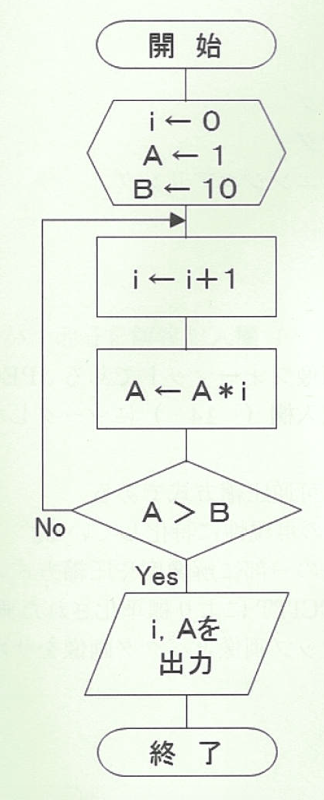{width=3.5cm} 1.   i=3, A=6
 2.   i=3, A=24
 3.   i=4, A=11
 4.   i=4, A=24
 5.   i=5, A=24
   問91.  図のフローチャートの実行結果はどれか。
 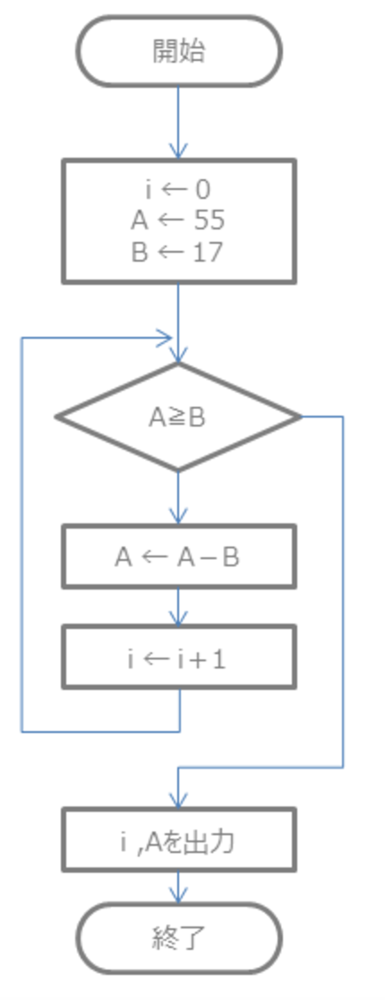{width=3.5cm} 1.   i = 2, A = 3
 2.   i = 2, A = 4
 3.   i = 3, A = 3
 4.   i = 3, A = 4
 5.   i = 4, A = 4
   問92.  関数$f(x)=\exp(\sin(x))$の$x=1.0$における微分を求める以下のC言語プログラムのaに入るものはどれか。
 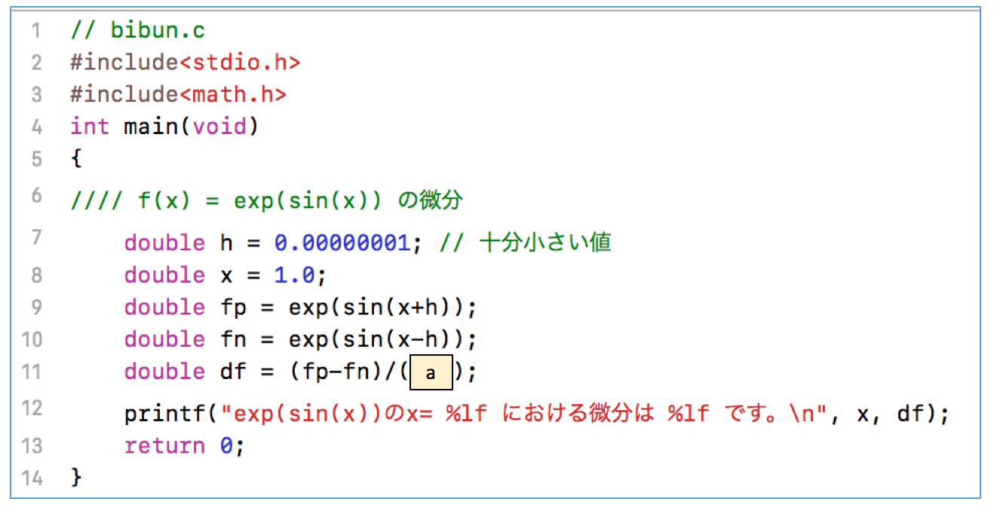{width=7cm} 1.   $h$
 2.   $2*h$
 3.   $x$
 4.   $2*x$
 5.   $\exp(\sin(x))*\cos(x)$
   問93.  コンパイラ方式の言語に分類されるのはどれか。
 1.   C++
 2.   SQL
 3.   XML
 4.   Perl
 5.   JavaScript
   問94.  コンパイルを必要とするプログラミング言語はどれか。
 1.  C
 2.  PHP
 3.  Perl
 4.  Ruby
 5.  JavaScript
   問95.  スクリプト言語はどれか。
 1.   BASIC
 2.   FORTRAN
 3.   Java
 4.   LISP
 5.   Perl
   問96.  プログラミング言語について正しいのはどれか。
 1.   Rubyは構造化言語である。
 2.   COBOLは関数型言語である。
 3.   PHPはマークアップ言語である。
 4.   Javaはオブジェクト指向言語である。
 5.   LISPは手続き型のプログラミング言語である。
   問97.  プログラミング言語について\underline{誤っている}のはどれか。
 1.   JavaScriptはスクリプト言語である
 2.   Javaはオブジェクト指向言語である
 3.   BASICはインタープリタ方式の言語である
 4.   FORTRANは科学技術向けの高級言語である
 5.   XMLは手続き型のプログラミング言語である
   問98.  バッチ処理の説明として正しいのはどれか。
 1.   サーバと端末で処理を分担する方式。
 2.   蓄えられたデータを一括して処理する方式。
 3.   複数のコンピュータで分散して処理する方式。
 4.   複数のプログラムを短時間づつ処理する方式。
 5.   複数端末からの要求を随時処理し結果を端末に返す方式。
   問99.  複数のプログラムを短時間ずつ順次実行して、同時に処理しているように見せかける処理方式はどれか。
 1.   バッチ処理
 2.   オンライン処理
 3.   リアルタイム処理
 4.   トランザクション処理
 5.   タイムシェアリング処理
   問100.  HTML (Hyper Text Markup Language)について\underline{誤っている}ものはどれか。
 1.   半構造化文書である。
 2.   記述にタグが必要である。
 3.   コンパイルが必要である。
 4.   テキストエディタで編集できる。
 5.   他の文書へのリンクを埋め込める。
   問101.  可逆圧縮の静止画像ファイル形式はどれか。
 1.   BMP
 2.   JPEG
 3.   MP4
 4.   PNG
 5.   WMA
   問102.  データ圧縮について正しいのはどれか。
 1.   可逆圧縮は非可逆圧縮より圧縮率を高くできる
 2.   テキストデータの圧縮には非可逆圧縮を用いる
 3.   画像データを可逆圧縮しても解像度は維持される
 4.   非可逆圧縮は圧縮前のデータに完全に復元できる
 5.   音データを可逆圧縮すると再生時にひずみが生じる
   問103.  標本化定理を表した式はどれか。ただし、$f_{max}$：再現したい信号周波数の上限、$f_{s}$：サンプリングの周波数。
 1.   $f_{s} <  f_{max}$
 2.   $f_{s} <  2f_{max}$
 3.   $f_{s} =  f_{max}$
 4.   $f_{s} > 2f_{max}$
 5.   $2f_{s} > f_{max}$
   問104.  データ圧縮について\underline{誤っている}のはどれか。
 1.   可逆圧縮は圧縮前のデータに復元できる。
 2.   テキストデータの圧縮には可逆圧縮を用いる。
 3.   可逆圧縮は非可逆圧縮よりも圧縮率を高くできる。
 4.   画像データを可逆圧縮しても解像度は維持される。
 5.   音データを非可逆圧縮すると再生時にひずみが生じる。
   問105.  データ圧縮について正しいのはどれか。
 1.   圧縮後の再圧縮により元データを復元できる
 2.   非可逆圧縮は可逆圧縮より圧縮率を高くできる
 3.   画像データは可逆圧縮により解像度が高くなる
 4.   テキストデータの圧縮には非可逆圧縮が用いられる
 5.   プログラムファイルを圧縮すると高速な動作になる
   問106.  非可逆圧縮方式はどれか。
 1.   LZ圧縮
 2.   予測符号化
 3.   算術符号化
 4.   ハフマン符号化
 5.   ランレングス符号化
   問107.  音声のデータ形式\underline{でない}のはどれか。
 1.   AAC
 2.   MP3
 3.   PNG
 4.   WMA
 5.   ATRAC3
   問108.  静止画像、動画像のいずれのデータ形式\underline{でない}のはどれか。
 1.   AVI
 2.   BMP
 3.   GIF
 4.   MP4
 5.   WAV
   問109.  動画像のデータ形式はどれか。
 1.   AVI
 2.   GIF
 3.   PNG
 4.   JPEG
 5.   TIFF
   問110.  動画像のデータ形式\underline{でない}のはどれか。
 1.   AVI
 2.   FLV
 3.   MP3
 4.   WMV
 5.   MPEG-4
   問111.  複数のファイルをひとつのファイルにまとめたものどれか。
 1.   CSVファイル
 2.   dllファイル
 3.   PDFファイル
 4.   xlsファイル
 5.   ZIPファイル
   問112.  音声のA/D変換について正しいのはどれか。
 1.   雑音成分は除去できる。
 2.   量子化は時間軸方向の標本化である。
 3.   サンプリングは時間軸方向の離散化である。
 4.   標本化間隔が大きいほど高い音が含まれる。
 5.   量子化ビット数が大きいと量子化誤差も大きくなる。
   問113.  A/D変換の処理の順序はどれか。
 1.   標本化　→　量子化　→　符号化
 2.   標本化　→　符号化　→　量子化
 3.   量子化　→　標本化　→　符号化
 4.   量子化　→　富豪化　→　標本化
 5.   符号化　→　標本化　→　量子化
   問114.  アナログ情報とデジタル情報との間の変換について\underline{誤っている}のはどれか。
 1.  量子化は標本化の次に行われる
 2.  連続量を離散化する事を量子化という
 3.  D/A変換により、もとの波形を完全に復元できる
 4.  波形情報を一定時間ごとに拾い上げる事を標本化という
 5.  A/D変換とは、アナログ情報をデジタル情報に変換する事をいう
   問115.  周波数成分の最大値が500Hzのアナログ信号をデジタル信号へ変換する場合、元の信号の情報を失わずにデジタル化するために必要な最小のサンプリング周波数はどれか。
 1.   125Hz
 2.   250Hz
 3.   500Hz
 4.   1,000Hz
 5.   2,000Hz
   問116.  アナログ信号を8kHzで標本化し10ビットで量子化するとき、1時間分のデータ量はどれか。
 1.   80キロバイト
 2.   600キロバイト
 3.   4.8メガバイト
 4.   36メガバイト
 5.   288メガバイト
   問117.  アナログ信号を1kHzでサンプリングし8ビットで量子化する場合、10秒間の信号のデータ量はどれか。
 1.   8キロバイト
 2.   8キロビット
 3.   10キロバイト
 4.   10キロビット
 5.   80キロバイト
   問118. 16進数の「36」と「25」の足し算の結果を2進数8桁で表したのはどれか。 1.  01010011 2.  01011011 3.  1101011 4.  10101001 5.  10110110   問119. イメージスキャナの解像度を表す単位はどれか。 1.  bps 2.  dpi 3.  fps 4.  rpm 5.  ppm   問120. 2進数1110と1011の各桁の排他的論理和(XOR)の演算結果はどれか。 1.  0011 2.  0101 3.  1010 4.  1100 5.  1101   問121. アナログ信号を1kHzでサンプリングし、8ビットで量子化したとき、10秒間の信号のデータ量はどれか。 1.  1キロバイト 2.  8キロバイト 3.  10キロバイト 4.  64キロバイト 5.  80キロバイト   問122. 複数のファイルを1つのファイルにまとめるアーカイブで使用されるデータ形式はどれか。 1.  BMP 2.  CSV 3.  PDF 4.  ZIP 5.  HTML   問123. ハードディスクを用いてRAID6でストレージを構成するとき、最低限必要な台数はどれか。 1.  1台 2.  2台 3.  3台 4.  4台 5.  5台   問124. ICカードリーダは、コンピュータを構成する5大装置のどれにあたるか。 1.  演算装置 2.  記憶装置 3.  出力装置 4.  制御装置 5.  入力装置   問125. デジタル映像信号と音声信号を伝送できるコネクタはどれか。 1.  DVI-D 2.  D-Sub15 3.  HDMI 4.  PS/2 5.  RJ-45   問126. アプリケーション機能をインターネット経由でサービスとして提供するのはどれか。 1.  DaaS 2.  laaS 3.  MaaS 4.  PaaS 5.  SaaS   問127. ハードウェアの基本的な制御を行うため、機器に組み込まれたソフトウエアはどれか。 1.  カーネル 2.  ドライバ 3.  ライブラリ 4.  ミドルウェア 5.  ファームウェア   問128. アプリケーションソフトウェアはどれか。 1.  BIOS 2.  Webブラウザ 3.  システムコール 4.  バッチファイル 5.  オペレーティングシステム   問129. マークアップ言語はどれか。 1.  C++ 2.  XML 3.  Java 4.  BASIC 5.  Python   問130. 図のフローチャートで、初期値をX=12、Y＝33のとき、実行結果はどれか。 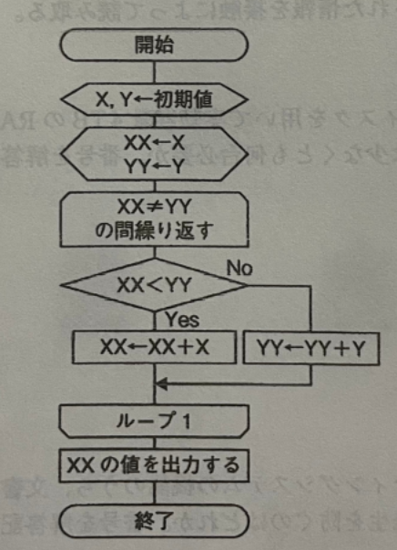{width=7cm} 1.  45 2.  66 3.  132 4.  264 5.  396   問131. 2進数「100」と16進数「10」の合計を10進数で表したのはどれか。 1.  16 2.  18 3.  20 4.  22 5.  24   問132. 単位の接頭辞が小さい順に並んでいるのはどれか。 1.  E<T<P<G 2.  G<T<P<E 3.  P<E<G<T 4.  P<T<E<G 5.  T<G<P<E   問133. 漢字を扱えない文字コードはどれか。 1.  ASCII 2.  UTF-8 3.  EUC-JP 4.  Shift-JIS 5.  ISO-2022-JP   問134. 画像データをグレースケール１０ビットで量子化した場合、表示可能な階調数はどれか。 1.  256 2.  512 3.  1024 4.  2048 5.  4096   問135. サンプリング周波数20Hz、16bitで量子化された2秒分のデータ量はどれか。 1.  40Bytes 2.  80Bytes 3.  160Bytes 4.  320Bytes 5.  640Bytes   問136. ファイル名の種類を識別する、ファイル名の末尾の文字列を表すのはどれか。 1.  タグ 2.  演算子 3.  拡張子 4.  フォルダ 5.  文字コード   問137. シンクライアントの特徴はどれか。 1.  サーバの負荷軽減 2.  情報漏洩対策が困難 3.  大量データの一括処理 4.  ピアツーピア型の通信 5.  端末にデータを持たない   問138. 半導体メモリに記録するのはどれか。 1.  BD 2.  CD 3.  DVD 4.  HDD 5.  SSD   問139. ディスプレイの規格でもっとも解像度が高いのはどれか。 1.  4K 2.  HD 3.  FHD 4.  XGA 5.  WUXGA   問140. ストライピングしたデータとパリティ値を各ディスクに分散して記録する方式はどれか。 1.  RAID0 2.  RAID1 3.  RAID5 4.  RAID01 5.  RAID10   問141. アナログ出力するコネクタはどれか。 1.  DisplayPort 2.  D-sub15 3.  HDMI 4.  USB(Type-B) 5.  USB(Type-C)   問142. 1行ごとに翻訳と実行を行いながらプログラム全体の処理を進める方式はどれか。 1.  アセンブラ 2.  コンパイラ 3.  インタプリタ 4.  オブジェクト 5.  マークアップ   問143. 10進数の101を2進数で表したのはどれか。 1.  1100101 2.  1100011 3.  1111001 4.  1111101 5.  1111110   問144. 読取りに青色半導体レーザを用いなければならないのはどれか。 1.  CD 2.  DVD 3.  ICカード 4.  SDメモリカード 5.  Blu-ray Disc   問145. フラッシュメモリについて正しいのはどれか。 1.  揮発性である。 2.  高速回転する。 3.  書き換えできる。 4.  磁気で読み出す。 5.  ランダムアクセスができない。   問146. 10進表記の倍数と情報の単位の接頭辞の組み合わせで正しいのはどれか。 1.  10$^3$-M 2.  10$^6$-G 3.  10$^9$-T 4.  10$^12$-E 5.  10$^15$-P   問147. 2進数「1010」と「1001」の論理演算の結果が「0111」となるのはどれか。 1.  論理和(OR) 2.  論理積(AND) 3.  否定論理和(NOR) 4.  排他的論理和(XOR) 5.  否定論理積(NAND)   問148. 画素数1,024×1,024の10bitグレースケール、フレームレート60fpsの非圧縮動画の1秒あたりの情報量はどれか。 1.  6Mbytes 2.  60Mbytes 3.  75Mbytes 4.  600Mbytes 5.  750Mbytes   問149. バッチ処理の説明として適切なのはどれか。 1.  処理を対話的に実行する方式 2.  登録した処理を自動的に一括実行する方式 3.  サーバとクライアントで処理を分担する方式 4.  同一の処理を多数のコンピュータに分散する方式 5.  複数の処理を短時間ずつ切り替えて実行する方式   問150. シンクライアントの方式でないのはどれか。 1.  仮想PC方式 2.  パイプライン方式 3.  ブレードPC方式 4.  ネットワークブート方式 5.  画面転送型サーバベース方式   問151. 仮想化の特徴でないのはどれか。 1.  サーバの集約化 2.  柔軟なリソース配分 3.  データ処理の高速化 4.  システムテストの効率化 5.  スナップショットからの復元   問152. RAID6で構成する場合、8TBのデータを格納するのに、1台2TBのディスク装置は最低何台必要か。 1.  4台 2.  5台 3.  6台 4.  8台 5.  10台   問153. 表計算ソフトウェアの操作のうち、オペレーティングシステム(OS)の機能を呼び出しているのはどれか。 1.  行の挿入 2.  列の非表示 3.  データのソート 4.  関数を使った計算 5.  ワークシートの印刷   問154. オペレーティングシステム(OS)から入出力装置など周辺機器を制御するためのプログラムはどれか。 1.  シェル 2.  カーネル 3.  ドライバ 4.  アセンブラ 5.  ファームウェア   問155. 図のフローチャートで、x=17、y＝3のとき、a、bの正しい出力の組み合わせはどれか。 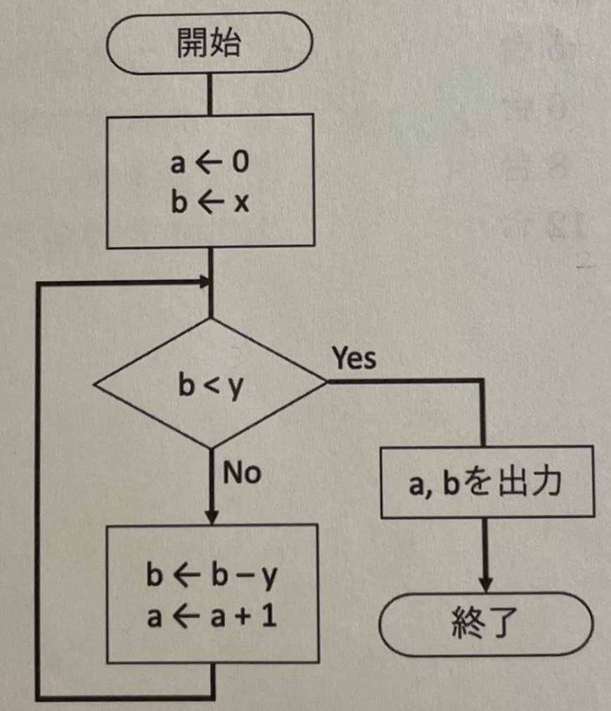{width=7cm} 1.  a = 2、　b = 5 2.  a = 4、　b = 3 3.  a = 5、　b = 2 4.  a = 6、　b = 5 5.  a = 7、　b = 2   問156. プログラミング言語のソースプログラム全体を、あらかじめ機械語のプログラムに変換しておいてから実行するのはどれか。 1.  手続き型言語 2.  アセンブリ言語 3.  コンパイラ方式 4.  インタプリタ方式 5.  マークアップ言語   問157. スクリプト言語はどれか。 1.  C# 2.  Java 3.  COBOL 4.  Prolog 5.  Python   問158. ASCIIコードでは、大文字アルファベット「A」は2進数の1000001で、「B」は1000010で表される。「E」を表す2進数のASCIIコードを16進数で表したのはどれか。 1.  41 2.  45 3.  4E 4.  52 5.  65   問159. 動画像のファイル形式はどれか。 1.  BMP 2.  MP4 3.  PNG 4.  FHIR 5.  JPEG   問160. 周波数成分の最大値が400Hzのアナログ信号をデジタル信号へ変換する場合、必要な最低サンプリング周波数はどれか。 1.  100Hz 2.  200Hz 3.  400Hz 4.  800Hz 5.   1,600Hz   問161. 可逆圧縮の説明として正しいのはどれか。 1.  圧縮前のデータに復元できる 2.  復元後の音声にひずみが生じる 3.  非可逆圧縮より圧縮率が高くなる 4.  復元後のテキスト情報が欠損する 5.  圧縮前後でファイルサイズが変化しない   問162. グレースケール画像の各画素の明るさを4,000段階に分けたい場合、量子化に必要な最小ビット数はどれか。 1.  10 2.  12 3.  14 4.  16 5.  20   問163. データ量が最も小さいのはどれか。 1.  4GByte 2.  4TByte 3.  0.4EByte 4.  0.8PByte 5.  800MByte   問164. 16進数「F8」を10進数で表したのはどれか。 1.  120 2.  128 3.  150 4.  248 5.  254   問165. 2進数の「10010」と「1010」の和を16進数で表したのはどれか。 1.  1A 2.  B1 3.  1C 4.  1F 5.  AB   問166. ベン図の網掛け部分が得られる演算はどれか。 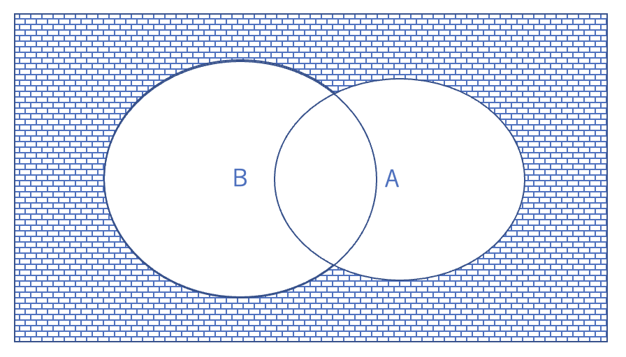{width=7cm} 1.  A OR B 2.  A AND B 3.  NOT (A OR B) 4.  NOT (A AND B) 5.  (NOT A) AND B   問167. 画素数が1,600×1,200で、24ビットカラー、非圧縮形式の画像8枚を保存できる最小の容量はどれか。 1.  50MByte 2.  5MByte 3.  0.5MByte 4.  0.5GByte 5.  500KByte   問168. VDIが指すのはどれか。 1.  仮想メモリ 2.  仮想現実感 3.  サーバ仮想化 4.  デスクトップ仮想化 5.  アプリケーション仮想化   問169. LTOについて正しいのはどれか。 1.  磁気で記録する。 2.  赤外線で記録する。 3.  レーザー光で記録する。 4.  ICチップに記録される。 5.  フラッシュメモリである。   問170. Full-HDディスプレイの解像度はどれか。 1.   1,280×1,024 2.   1,920×1,080 3.   1,920×1,200 4.   4,096×2,160 5.   7,680×4,320   問171. CPUの基本動作を表す図の①～④に入る正しい組み合わせはどれか。(図あり)。 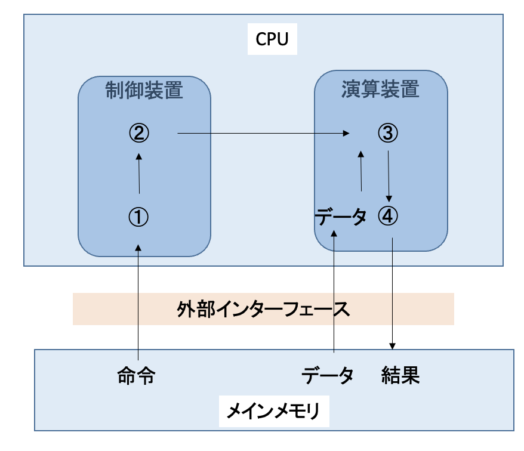{width=7cm} 1.  ①解読-②実行-③読込-④出力 2.  ①解読-②読込-③出力-④実行 3.  ①読込-②解読-③実行-④出力 4.  ①読込-②解読-③出力-④実行 5.  ①実行-②読込-③解読-④出力   問172. スマートデバイスの集中管理や機能制限を行うシステムはどれか。 1.  DRM 2.  MDM 3.  BYOD 4.  MIMO 5.  MVNO   問173. オペレーティングシステムはどれか。 1.  FHIR 2.  Java 3.  Ruby 4.  Apache 5.  Android   問174. プログラムで扱う変数の型のうち、論理型に必要な情報量はどれか。 1.  1bit 2.  2bit 3.  4bit 4.  8bit 5.  16bit   問175. 図に示すデータ構造はどれか。 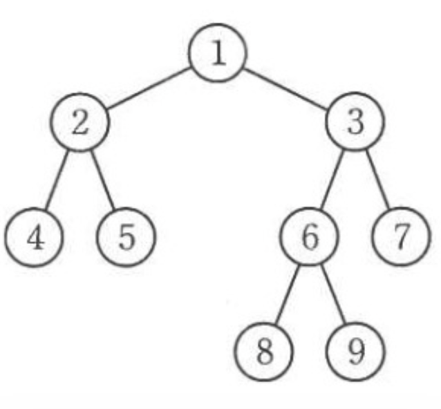{width=7cm} 1.  キュー 2.  ツリー 3.  リスト 4.  スタック 5.  ネットワーク   問176. アナログ信号をデジタル信号へ変換する処理順序はどれか。 1.  標本化→量子化→符号化 2.  符号化→量子化→標本化 3.  量子化→標本化→符号化 4.  量子化→符号化→標本化 5.  符号化→標本化→量子化   問177. DICOM ヘッダのメタ情報を構成するのはどれか。2 つ選べ。 1.  画像 2.  タグ 3.  データ長 4.  プリアンブル 5.  プリフィックス   問178. 排反する 2 つの事象の生起確率がそれぞれ 0.4 と 0.6 であるとき、2 つの事象 のエントロピー [bit] はどれか。ただし、$\log_2{0.4} = -1.3$ および $\log_2{0.6} = -0.7$ とする。 1.  -0.26 2.  -0.94 3.  0.10 4.  0.94 5.  2.6   問179. ガウス雑音を含む周期信号を 100 回同期加算平均した。SN 比は 1 回測定の何倍 か。 1.  0.01 2.  0.1 3.  1 4.  10 5.  100   問180. 10進法の10.2を2進法に変換した値はどれか。 ただし、小数点は第4位まで表示されたものとする。 1.  1010.0011 2.  1010.0110 3.  1100.1001 4.  1100.1100 5.  1110.1001   問181. データ圧縮で誤っているのはどれか。 1.  画像の冗長性を利用して行われる。 2.  動画のデータ圧縮にMPEGがある。 3.  可逆圧縮は1/10～1/20程度の圧縮が可能である。 4.  圧縮後のデータ容量圧縮前のデータ容量に圧縮率を乗算して算出される。 5.  可逆圧縮は圧縮データを完全な状態で元のデータに復元可能な圧縮である   問182. ブール代数の基本定理で誤っているのはどれか。 1.  A+0=A 2.  A+1=1 3.  A+A=2A 4.  A・1=A 5.  A・A=A   問183. 基本ソフトウェアのユーザーインターフェイスはどれか。2つ選べ。 1.  OS 2.  CPU 3.  CUI 4.  GPU 5.  GUI   問184. コンピュータのCPUの機能はどれか。 1.  演算 2.  記憶 3.  出力 4.  保管 5.  入力   問185. 入力A、Bが0・1で与えられたときの出力を真理値表に示す。対応する論理演算はどれか。 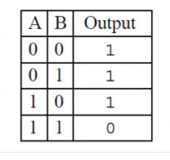{width=7cm} 1.  OR 2.  AND 3.  NOR 4.  XOR 5.  NAND   