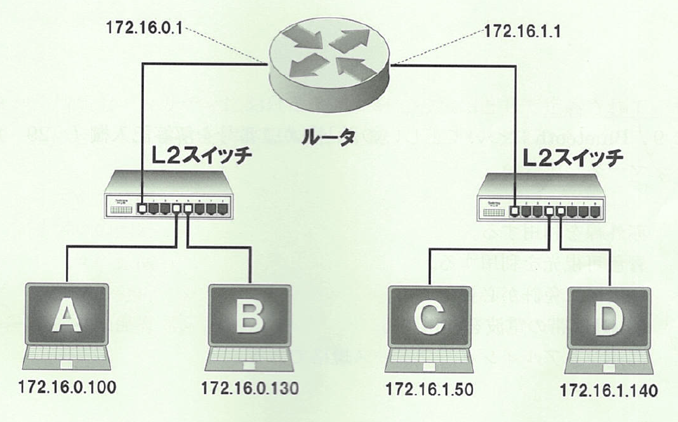
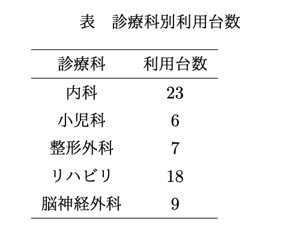
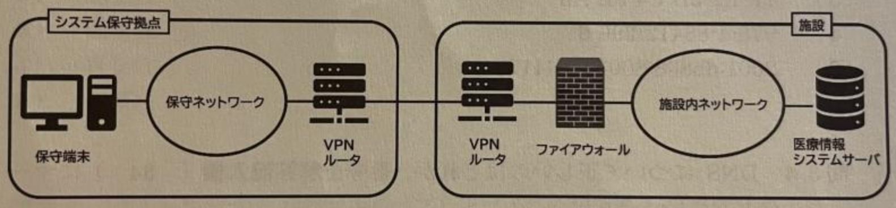

# 2025年度医用画像情報学II（後期）

# 演習問題

問01.  CAT6（カテゴリー6）規格のUTPケーブルにおける最大転送速度はどれか。
 1.   1Mbps
 2.   10Mbps
 3.   100Mbps
 4.   1Gbps
 5.   10Gbps
   問02.  ルータはOSI基本参照モデルのどの層に属するか。
 1.   セッション層
 2.   データリンク層
 3.   ネットワーク層
 4.   トランスポート層
 5.   アプリケーション層
   問03.  帯域が1,000Mbpsのネットワーク回線で、データ型が16 bitの512$\times$512のCT画像40枚のデータを転送するのに要する理論上の時間に最も近いのはどれか。
 1.   0.005秒
 2.   0.17秒
 3.   0.32秒
 4.   3.2秒
 5.   25秒
   問04.  NATについて正しいのはどれか。
 1.   IPアドレスを変換する
 2.   ポートアドレスを変換する
 3.   ネットワークの設定を自動化する
 4.   仮想プライベートネットワークを構築する
 5.   ドメイン名とIPアドレスを分散的に管理する
   問05.  サブネットマスクが255.255.255.128である２つのネットワークに接続された端末A,B,C,Dのうち、ルータを介して相互に通信可能な端末の組み合わせはどれか。
 {width=7cm} 1.   AとC
 2.   AとD
 3.   BとC
 4.   BとD
 5.   なし
   問06.  IPアドレスを動的に割り当てるプロトコルはどれか。
 1.   ARP
 2.   NTP
 3.   PPP
 4.   DHCP
 5.   SNMP
   問07.  サブネットマスクが26ビットのIPv4のネットワークで接続可能な最大ホスト数はどれか。
 1.   14
 2.   30
 3.   62
 4.   126
 5.   254
   問08.  サブネットマスク255.255.252.0のネットワークで割り当て可能なホストアドレスの最大数はどれか。
 1.   510
 2.   512
 3.   1020
 4.   1022
 5.   1024
   問09.  サブネットマスクとして\underline{誤っている}のはどれか。
 1.   255.255.255.224
 2.   255.255.255.0
 3.   255.255.240.0
 4.   255.255.192.0
 5.   255.255.112.0
   問10.  172.17.0.0/21で表されるネットワークのサブネットマスクはどれか。
 1.   255.255.192.0
 2.   255.255.240.0
 3.   255.255.248.0
 4.   255.255.255.128
 5.   255.255.255.240
   問11.  サブネットマスクが24ビットの場合、IPアドレスを192.168.13.10と設定した端末と同一のサブネットに接続される端末のIPアドレスとして適切なのはどれか。
 1.   192.168.12.10
 2.   192.168.13.10
 3.   192.168.13.24
 4.   192.168.14.10
 5.   192.168.14.24
   問12.  IPアドレス172.30.123.45、サブネットマスクが255.255.252.0のホストが属するネットワークアドレスはどれか。
 1.   172.30.0.0
 2.   172.30.3.0
 3.   172.30.120.0
 4.   172.30.123.0
 5.   172.30.252.0
   問13.  表に示す診療科に設置されたすべての端末が同じサブネットに属するために必要なネットワークアドレスの最大ビット数はどれか。なお、サーバは別のサブネットにあるものとする。
 {width=7cm} 1.   22ビット
 2.   23ビット
 3.   24ビット
 4.   25ビット
 5.   26ビット
   問14.  MACアドレスは何ビットか。
 1.   6
 2.   16
 3.   24
 4.   32
 5.   48
   問15.  以下の出力を得られるネットワーク管理コマンドはどれか。
 1.   ftp
 2.   ipconfig
 3.   ping
 4.   telnet
 5.   tracert
   問16.  pingの役割について正しいのはどれか。
 1.   通信先端末の反応を確認する。
 2.   サーバにファイルを転送する。
 3.   通信先までの途中経路を調べる。
 4.   ホスト名からIPアドレスを調べる。
 5.   IPアドレスからホスト名を調べる。
   問17.  通信プロトコルについて正しいのはどれか。
 1.   通信障害時の対策
 2.   データ送受信テスト手順
 3.   データ送受信時の付加情報
 4.   ネットワークシステム設計書
 5.   データ送受信の手続きと規約
   問18.  通信速度を表す単位はどれか。
 1.   bps
 2.   cps
 3.   fps
 4.   FLOPS
 5.   MIPS
   問19.  pingで使われるプロトコルはどれか。
 1.   ICMP
 2.   OSPF
 3.   PPTP
 4.   RARP
 5.   SNMP
   問20.  コネクションレスのプロトコルはどれか。
 1.   ICMP
 2.   PPP
 3.   SMTP
 4.   TCP
 5.   UDP
   問21.  インターネット上の資源にアクセスするための方法とその位置を指定する記法はどれか。
 1.  CGI
 2.  HTML
 3.  HTTP
 4.  URL
 5.  XML
   問22.  ネットワーク内のクライアントに通信を行うための設定情報を提供するプロトコルはどれか。
 1.   DHCP
 2.   HTTP
 3.   NTP
 4.   PPP
 5.   SNMP
   問23.  IPアドレスからMACアドレスを求めるプロトコルはどれか。
 1.   ARP
 2.   HTTP
 3.   SIP
 4.   SNMP
 5.   TCP
   問24.  MACアドレスからIPアドレスを求めるプロトコルはどれか。
 1.   ARP
 2.   DHCP
 3.   DNS
 4.   ICMP
 5.   RARP
   問25.  プライベートIPアドレスを持つ端末からインターネット接続するために必要な技術はどれか。
 1.   CIDR
 2.   ICMP
 3.   IMAP
 4.   NAPT
 5.   POP
   問26.  電子メールに\underline{関係のない}プロトコルはどれか。
 1.   SMTP
 2.   POP3
 3.   IMAP4
 4.   S/MIME
 5.   ICMP
   問27.  電子メールを送信するのに使われるプロトコルはどれか。
 1.   FTP
 2.   IMAP
 3.   NTP
 4.   POP3
 5.   SMTP
   問28.  電子メールの受信に使用するプロトコルはどれか。
 1.   FTP
 2.   POP
 3.   SSH
 4.   WEP
 5.   WPA
   問29.  限られたグローバルIPアドレスを有効に利用する技術はどれか。
 1.   DNS
 2.   NAT
 3.   NIC
 4.   UDP
 5.   UTP
   問30.  ネットワークを利用して時計を同期するプロトコルはどれか。
 1.   NDP
 2.   NTP
 3.   NNTP
 4.   SMTP
 5.   SNMP
   問31.  通信プロトコルとサービスの組み合わせで\underline{誤っている}のはどれか。
 1.   FTP - ファイルの転送
 2.   HTTP - WWWの閲覧
 3.   IMAP4 - 電子メールの送信
 4.   NTP - 時刻の同期
 5.   POP3 - 電子メールの受信
   問32.  http://www.jami.jp/index.htmlにアクセスした際に、「404 Not Found」と表示された。原因として考えられるのはどれか。
 1.   ページが存在しない
 2.   DNSサーバが停止していた
 3.   サーバの内部処理が不正である
 4.   ファイルへのアクセス権がない
 5.   当該のWebサーバが停止していた
   問33.  hana@hcit.jp宛てにメール送信したところ、``Host Unknown"と書かれたエラーメッセージが届いた。原因として正しいと思われるのはどれか。
 1.   迷惑メールとして処理された。
 2.   hcit.jpというメールサーバがない。
 3.   送信したメールサイズが大きすぎた。
 4.   hcit.jpにhanaというアドレス（ユーザ）がない。
 5.   送信先のメール保存領域が制限を超えた。
   問34.  メール送信後に、``User Unknown"と書かれたエラーメッセージが届いた。原因として正しいと思われるのはどれか。
 1.   迷惑メールとして判定された。
 2.   宛先のアドレスが正しくなかった。
 3.   メールの保存領域が制限を超えた。
 4.   転送先で送信元に転送されていた。
 5.   送信元アドレスが存在しなかった。
   問35.  以下のURLの8080は何を表す数字か。
 1.   共通鍵
 2.   ユーザー数
 3.   ハッシュ値
 4.   ポート番号
 5.   IPアドレス
   問36.  WANの説明として適切なのはどれか。
 1.   構内ネットワークである。
 2.   インターネットの別名である。
 3.   広域無線ネットワークのことである。
 4.   接続範囲を限定したネットワークである。
 5.   複数のLAN間を接続するネットワークである。
   問37.  TCP/IPの記述のうち\underline{誤っている}のはどれか。
 1.   IPアドレス長は32ビットである。
 2.   電子メールの送受信を規定している。
 3.   TCPとIPの２つを合わせたものである。
 4.   コネクション型の通信サービスを提供する。
 5.   データをパケット単位に分割して転送する。
   問38.  ARPを用いて行うのはどれか。
 1.   IPアドレスを動的に割り当てる。
 2.   MACアドレスの設定変更をする。
 3.   IPアドレスからホスト名を求める。
 4.   ホスト名からIPアドレスを求める。
 5.   IPアドレスからMACアドレスを求める。
   問39.  NATの利用により実現できるのはどれか。
 1.   MACアドレスをホスト名に変換できる。
 2.   ネットワーク上の通信データを暗号化できる。
 3.   限られたグローバルIPアドレスを有効に利用できる。
 4.   物理的な接続とは異なる仮想的なネットワークを構成できる。
 5.   同一ネットワーク内で同じプライベートIPアドレスを複数の端末に設定できる。
   問40.  NAPTで変換されるのはどれか。
 1.   ホスト名
 2.   ポート番号
 3.   ネットマスク
 4.   MACアドレス
 5.   ネットワークアドレス
   問41.  ポート番号の説明で正しいのはどれか。
 1.   32ビットの2進数で表現される。
 2.   組織ごとに割り当てられる領域がある。
 3.   工場出荷時に設定される固定番号である。
 4.   通信サービスを区別するための番号である。
 5.   アクセスポイントを識別するための番号である。
   問42.  IPアドレス(IPv4)に関する記述として正しいのはどれか。
 1.   128ビットで構成される。
 2.   製造者固有番号が含まれている。
 3.   グローバルアドレスは自由に設定できる。
 4.   ホスト部によりネットワークが識別できる。
 5.   192.168.0.0/16はプライベートアドレスである。
   問43.  IPv6について\underline{誤っている}のはどれか。
 1.   アドレス空間は256ビットで表現される。
 2.   基本的なルーティングの考え方はIPv4と同様である。
 3.   ネットワークプレフィックスとインターフェイス識別子で構成されている。
 4.   リンクローカルアドレスは同一リンク内の重複がないことを保証する。
 5.   ユーザ認証やパケット暗号化などのセキュリティ機能をサポートしている。
   問44.  DHCPの説明について正しいのはどれか。
 1.   時刻を同期するためのプロトコルである。
 2.   Webページを検索するためのプロトコルである。
 3.   電子メールを受信するためのプロトコルである。
 4.   IPアドレスを自動的に割り当てるためのプロトコルである。
 5.   MACアドレスからIPアドレスを求めるためのプロトコルである。
   問45.  DNSについて正しいのはどれか。
 1.   ポートを変換する。
 2.   ホスト名を解析する。
 3.   通信の経路制御を行う。
 4.   電子メールを配送する。
 5.   正確な時刻情報を提供する。
   問46.  DNSについて正しいのはどれか。
 1.   ポートを変換する。
 2.   通信の経路制御を行う。
 3.   電子メールの転送先を解析する。
 4.   IPアドレスを自動的に割り振る。
 5.   MACアドレスとIPアドレスを関連付ける。
   問47.  DHCPで割り当て可能な情報はどれか。
 1.   ウイルス
 2.   ユーザーID
 3.   MACアドレス
 4.   メールアドレス
 5.   DNSサーバーアドレス
   問48.  複数のLANをネットワーク層で相互に接続するのに使用する装置はどれか。
 1.   ハブ
 2.   ルータ
 3.   ブリッジ
 4.   リピータ
 5.   ゲートウェイ
   問49.  OSI参照モデルでデータ送受信のタイミングとエラー処理の制御を担当する層はどれか。
 1.   物理層
 2.   データリンク層
 3.   ネットワーク層
 4.   トランスポート層
 5.   セッション層
   問50.  OSI参照モデルの第７層について正しいのはどれか。
 1.   通信のセッション管理を行う。
 2.   データを物理信号に対応させる。
 3.   データの表現形式を規定している。
 4.   ネットワーク間の経路を制御する。
 5.   アプリケーションサービスを提供する。
   問51.  複数のLANを接続し中継するために用いるデータリンク層の装置はどれか。
 1.   ルータ
 2.   ブリッジ
 3.   リピータ
 4.   ゲートウェイ
 5.   ファイアウォール
   問52.  OSI参照モデルの物理層について正しいのはどれか。
 1.   プロトコルの確認
 2.   データ衝突の確認
 3.   データ宛先の確認
 4.   データの符号化と復号
 5.   媒体上でのビット列の伝送
   問53.  OSI参照モデルの物理層において中継を行う機器はどれか。
 1.   ルータ
 2.   ブリッジ
 3.   リピータ
 4.   ゲートウェイ
 5.   スイッチングハブ
   問54.  ネットワーク層でデータを選択的に他のネットワークへ中継する機器はどれか。
 1.   ルータ
 2.   L2スイッチ
 3.   ブリッジ
 4.   リピータ
 5.   ファイアウォール
   問55.  IPsecはOSI基本参照モデルのどの層に属するプロトコルか。
 1.   アプリケーション層
 2.   セッション層
 3.   トランスポート層
 4.   ネットワーク層
 5.   データリンク層
   問56.  イーサネットの伝送媒体について正しいのはどれか。
 1.   10BASE-Tの伝送速度は10Tbpsである。
 2.   100BASE-TXの伝送速度は100Gbpsである。
 3.   1000BASE-Tの最大伝送距離は100mである。
 4.   1000BASE-LXの伝送速度は1,000kbpsである。
 5.   1000BASE-SXの最大伝送距離は1,000kmである。
   問57.  UTPケーブルについて正しいのはどれか。
 1.   光を用いて通信する。
 2.   終端装置が必要である。
 3.   電磁シールドされている。
 4.   同軸ケーブルの一つである。
 5.   2本の銅線を撚りあわせている。
   問58.  UTPケーブルの最大伝達距離はどれか。
 1.   100m
 2.   300m
 3.   550m
 4.   2,000m
 5.   5,000m
   問59.  光ファイバーケーブルについて正しいのはどれか。
 1.   カテゴリ区分がある。
 2.   電磁波の影響を受けない。
 3.   自由に折り曲げることができる。
 4.   ３芯一組で用いるのが基本である。
 5.   クロスケーブルとストレートケーブルがある。
   問60.  VLANについて\underline{誤っている}記述はどれか。
 1.   同一ネットワーク内のデータが暗号化される。
 2.   スイッチ上のポートに個別のVLANを割り当てる。
 3.   物理的な接続とは異なる仮想的なネットワークを構成できる。
 4.   複数の独立したVLANを同一の配線上に流すことができる。
 5.   1台のスイッチを複数の独立したスイッチのように作動させる。
   問61.  VLANについて正しい記述はどれか。
 1.   暗号化して通信できる。
 2.   コンピュータウイルスを駆除できる。
 3.   物理的なネットワーク機器が不要になる。
 4.   自動的にIPアドレスが割り当てられる。
 5.   物理的な接続とは異なる仮想的なネットワークを構成できる。
   問62.  P2Pがよく使われるサービスはどれか。
 1.   ASP
 2.   IP電話
 3.   SaaS
 4.   プリンタ共有
 5.   クラウドストレージ
   問63.  無線LANで用いられるローミングについて正しいのはどれか。
 1.   気象レーダー等の影響を受けること
 2.   アクセスポイント間の電波干渉を防ぐこと
 3.   接続先のアクセスポイントを識別すること
 4.   接続先のアクセスポイントを切り替えること
 5.   アクセスポイントが接続の可否を判断すること
   問64.  Bluetoothについて正しいのはどれか。
 1.   赤外線を利用する
 2.   青色可視光を利用する
 3.   利用には免許が必要である
 4.   2.4GHz帯の電波を利用する
 5.   高速シリアルインターフェース規格である
   問65.  物理的な接続とは異なる仮想的なネットワークはどれか。
 1.   VDI
 2.   VLAN
 3.   VOD
 4.   WebDAV
 5.   WLAN
   問66.  無線LAN技術の説明のうち\underline{誤っている}ものはどれか。
 1.   WPAではTKIPが使用されている。
 2.   WEPは電波に乗せるデータを暗号化する技術である。
 3.   ESS-IDを用いることによってユーザ認証が可能になる。
 4.   WPAはWEPのセキュリティ上の欠点を補うために開発された。
 5.   ESS-IDはアクセスポイントが提供する無線LANネットワークの名称である。
   問67.  無線LANについて\underline{誤っている}のはどれか。
 1.   複数端末間の直接的な無線通信をアドホックモードという
 2.   周辺のアクセスポイントの数に比例して通信速度は速くなる
 3.   電波強度が充分であれば、違うフロアのアクセスポイントも利用できる
 4.   IEEE802.11g規格で混線なしに同時に使用できるチャンネル数は3つである
 5.   セッションを切らずに異なるアクセスポイントとの通信に移ることをローミングという
   問68.  無線LANのネットワークを区別するために、アクセスポイントに設定する識別子はどれか。
 1.   EAP
 2.   SSID
 3.   TKIP
 4.   WEP
 5.   WPA
   問69.  無線LANのアクセスポイントを識別するための情報はどれか。
 1.   ホスト名
 2.   ESS-ID
 3.   WPAキー
 4.   MACアドレス
 5.   デフォルトゲートウェイ
   問70.  伝送速度(理論値)が最大の無線LANの規格はどれか。
 1.   IEEE802.11a
 2.   IEEE802.11b
 3.   IEEE802.11g
 4.   IEEE802.11n
 5.   IEEE802.11ac
   問71.  無線LANの規格のうち、2.4GHz帯と5GHz帯の両方の周波数の電波を用いるのはどれか。
 1.   IEEE802.11b
 2.   IEEE802.11g
 3.   IEEE802.11a
 4.   IEEE802.11n
 5.   IEEE802.11ac
   問72.  2.4GHz/5GHzの周波数帯を用い、最大伝送速度600Mbps、実効伝送速度100Mbps以上の無線LANの規格はどれか。
 1.   ZigBee
 2.   Bluetooth
 3.   IEEE802.11a
 4.   IEEE802.11g
 5.   IEEE802.11n
   問73.  無線LANの規格と説明の組み合わせで\underline{誤っている}のはどれか。
 1.   IEEE802.11a - 最大伝送速度54Mbps
 2.   IEEE802.11b - 最大伝送速度11Mbps
 3.   IEEE802.11g - 周波数帯2.4GHz
 4.   IEEE802.11n - 最大伝送速度1Gbps
 5.   IEEE802.15.4 - 周波数帯2.4GHz
   問74.  5Gの説明において\underline{誤っている}のはどれか。
 1.   第五世代移動通信システムの略称である。
 2.   通信速度が1Gbpsを超える。
 3.   同時に接続できる端末の台数が4Gの数倍以上である。
 4.   4Gに比べ、利用する電波の直進性は高い。
 5.   4Gに比べ、タイムラグが大きい。
   問75.  10MBのデータを10Mbpsの回線で転送するための最短所要時間はどれか。
 1.   1秒
 2.   4秒
 3.   8秒
 4.   16秒
 5.   32秒
   問76.  2,048kBの画像を20Mbpsの伝送速度で伝送できる場合の最短所要時間はどれか。
 1.   0.1秒
 2.   0.8秒
 3.   1.2秒
 4.   8.0秒
 5.   12.8秒
   問77.  伝送速度1Gbpsのネットワークシステムで、1枚8メガビットの画像を送信する場合、伝送効率を100\%として1秒間に送信完了できる画像数はどれか。
 1.   8
 2.   15
 3.   100
 4.   125
 5.   250
   問78.  通信速度が1Gbpsのネットワークでデータを送信した結果、1秒間あたり5MBのデータを受信できた。この場合の回線利用率は何\%か。
 1.   2\%
 2.   3\%
 3.   4\%
 4.   5\%
 5.   6\%
   問79. 1台のコンピュータで複数のサービスが動作している場合に用いられるポート番号は、OSI参照モデルのどの層で扱われる情報か。 1.  物理層 2.  セッション層 3.  ネットワーク層 4.  トランスポート層 5.  アプリケーション層   問80. IPv4とIPv6のアドレスの特徴で共通なのはどれか。 1.  クラスが定義されている。 2.  アドレスの長さが同じである。 3.  プレフィックス長が定義されている。 4.  ARPでMACアドレスと対応付ける。 5.  ブロードキャストアドレスが定義されている。   問81. サーバ間で電子メールの配送に用いるプロトコルはどれか。 1.  FTP 2.  SSH 3.  SMTP 4.  SNMP 5.  IMAP4s   問82. 物理層の処理のみを行うネットワーク機器はどれか。 1.  ルータ 2.  ブリッジ 3.  リピータ 4.  L2スイッチ 5.  L3スイッチ   問83. LAN同士を接続する、または遠距離を結ぶネットワークはどれか。 1.  BAN 2.  CAN 3.  MAN 4.  PAN 5.  WAN   問84. Wi-Fiの通信を多重化する技術はどれか。 1.  DFS 2.  WEP 3.  WPA 4.  MIMO 5.  ローミング   問85. 通信機器でIPパケットを転送する際に、宛先IPアドレスや送信元IPアドレスを書き換える仕組みはどれか。 1.  AD 2.  NAT 3.  UDP 4.  LDAP 5.  VLAN   問86. OSI参照モデルにおける「ネットワーク層」で処理されるプロトコルはどれか。 1.  IP 2.  TCP 3.  UDP 4.  DHCP 5.  SMTP   問87. NAPTで変換されるのはどれか。 1.  SSID 2.  ホスト名 3.  ポート番号 4.  MACアドレス 5.  サブネットマスク   問88. WebブラウザとWebサーバの間でデータの送受信を行うために使用される通信プロトコルはどれか。 1.  DNS 2.  SSH 3.  SNMP 4.  HTTPS 5.  SMTPS   問89. IMAP4の用途はどれか。 1.  音声通話 2.  動画配信 3.  Web会議 4.  メール閲覧 5.  ルーティング   問90. サブネットマスク24ビットで、IPアドレスを192.168.3.10と設定した端末がある。この端末と同一のサブネットに接続する端末のIPアドレスとして適切なのはどれか。 1.  192.168.2.10 2.  192.168.3.10 3.  192.168.3.24 4.  192.168.4.10 5.  192.168.4.24   問91. 通信先端末の反応を確認するコマンドはどれか。 1.  arp 2.  ping 3.  netstat 4.  ipconfig 5.  nslookup   問92. PoEの機能はどれか。 1.  ワイヤレス給電 2.  光信号と電気信号の変換 3.  LANポートからの電源供給 4.  アクセスポイントの遠隔設定 5.  ネットワーク機器の遠隔監視   問93. ネットワークに接続されている機器の時刻を同期するプロトコルはどれか。 1.  NTP 2.  RTP 3.  DHCP 4.  LDAP 5.  PPPoE   問94. 無線LANで接続先のネットワークの識別に用いられるのはどれか。 1.  UDID 2.  ESSID 3.  ユーザID 4.  IPアドレス 5.  MACアドレス   問95. 次のIPアドレスのうち、アドレス変換を行わずインターネット上の機器と直接通信できるものはどれか。 1.  8.8.8.8 2.  10.10.1.1 3.  127.0.0.1 4.  172.32.2.2 5.  192.168.3.3   問96. HTTPSに割り当てられているウェルノウンポート番号はどれか。 1.  22 2.  80 3.  123 4.  443 5.  995   問97. foobar@hcit.jp宛にメール送信したところ“Host Unknown”と書かれたエラーメッセージが届いた。原因として正しいのはどれか。 1.  迷惑メールと判定された 2.  送信元アドレスが存在しなかった 3.  送信したメールサイズが大きすぎた 4.  hcit.jpというメールサーバが見つからない 5.  hcit.jpにfoobarというユーザがない   問98. 光ファイバケーブルの説明で正しいのはどれか。 1.  カテゴリ分けがある 2.  RJ45コネクタで接続する 3.  8本の芯線を撚り合わせている 4.  マルチモードとシングルモードがある 5.  結線方法にストレートとクロスがある   問99. 無線LAN(2.4GHz帯)の通信で干渉源となり得るのはどれか。 1.  PHS 2.  ICタグ 3.  携帯電話 4.  気象レーダ 5.  電子レンジ   問100. 下の図のような保守環境において、ファイアウォールはすべての通信を許可するポリシー設定をして運用している。保守ネットワークからの通信をリモートデスクトップ接続用のプロトコルのみに制限したい。ファイアウォールで変更すべき設定項目はどれか。 {width=7cm} 1.  宛先ポート番号 2.  接続許可時間帯 3.  送信元ポート番号 4.  宛先IPアドレス 5.  送信元IPアドレス   問101. IPアドレスが192.168.1.62のホストが属する、サブネットマスク225.225.225.128のネットワークのネットワークアドレスはどれか。 1.  192.168.1.0 2.  192.168.1.32 3.  192.168.1.64 4.  192.168.1.128 5.  192.168.1.255   問102. IPv6のアドレスはどれか。 1.  192.0.2.5 2.  00:00:5E:00:53:C3 3.  1F-E2-3D-C4-5B-A6 4.  978-4-88412-296-6 5.  2001:db8::8:800:200c:417a   問103. DNSについて正しいのはどれか。 1.  電子メールを配送する 2.  通信の経路制御を行う 3.  IPアドレスを自動的に割り当てる 4.  IPアドレスからMACアドレスを求める 5.  IPアドレスとドメイン名の対応付けをする   問104. 物理的な接続と異なる仮想的なネットワークはどれか。 1.  VDI 2.  VGA 3.  WAN 4.  VLAN 5.  WINS   問105. IPv6の説明として適切なのはどれか。 1.  無線LANでは使えない。 2.  IPv4とは直接通信できない。 3.  アドレス長は32ビットである。 4.  暗号化はサポートされていない。 5.  IPパケットのヘッダは可変長である。   問106. 192.168.32.0/22のネットワークが持つホスト部のアドレス数はどれか。 1.  128 2.  256 3.  512 4.   1,024 5.   2,048   問107. プライベートIPアドレスの複数の端末が、1つのグローバルIPアドレスを用いたインターネット接続を可能にする仕組みはどれか。 1.  CIDR 2.  ICMP 3.  NAPT 4.  SNMP 5.  RADIUS   問108. LAN内でループ構成を回避するためのデータリンク層の通信プロトコルを表すのはどれか。 1.  トークンリング 2.  フレームリレー 3.  スパニングツリー 4.  マルチホーミング 5.  リンクアグリゲーション   問109. IPアドレスなどのネットワーク情報を提供するプロトコルはどれか。 1.  FTP 2.  DHCP 3.  HTTP 4.  POP3 5.  SMTP   問110. 送信相手までの経路が不明な場合のデータ送信先として設定されるのはどれか。 1.  DNSサーバ 2.  LDAPサーバ 3.  WINSサーバ 4.  デフォルトゲートウェイ 5.  リンクローカルアドレス   問111. インターネット上に構築された、あたかも専用線のように使うことができる仮想的なネットワークはどれか。 1.  VDT 2.  VOD 3.  VPN 4.  VLAN 5.  VoIP   問112. 理論上の伝送速度が最大の無線LANの規格はどれか。 1.  IEEE802.11a 2.  IEEE802.11b 3.  IEEE802.11ac 4.  IEEE802.11n 5.  IEEE802.11g   問113. 1GByteのファイルを1Gbpsの回線でダウンロードするのに要する時間はどれか。ただし、伝送効率を50%とする。 1.  1秒 2.  4秒 3.  8秒 4.  16秒 5.  32秒   問114. WebサーバーとWebブラウザとの間でユーザーのログイン状態などを管理する情報を保持する仕組みはどれか。 1.  CGI 2.  CSS 3.  URL 4.  HTML 5.  Cookie   問115. ホスト名からIPアドレスを確認する際に利用するコマンドはどれか。 1.  ping 2.  netstat 3.  tracert 4.  ipconfig 5.  nslookup   問116. IPv4 で 192.168.1.0/24 のネットワークに接続可能なホストの最大数はどれか。 1.  24 2.  62 3.  126 4.  254 5.  256   問117. TCP/IPモデルのインターネット層のプロトコルはどれか。 1.  FTP 2.  HTTP 3.  IP 4.  POP3 5.  SMTP   問118. 正しい組合せはどれか。2つ選べ。 1.  USB-パラレルインターフェース 2.  FTP-セキュアなファイル転送 3.  SMTP-電子メール受信用プロトコル 4.  TCP/IP-ネットワークプロトコル 5.  MACアドレス-機器固有の物理アドレス   