# 2025年度医用画像情報学II（後期）

# 演習問題

問01. 画像圧縮に用いられる手法はどれか。 1.  ウィンドウ処理 2.  ボケマスク処理 3.  離散コサイン変換 4.  ヒストグラム平坦化 5.  サブトラクション処理   問02. 図 A に 1 次元フィルタ (-1, 1, 0) で畳み込み処理したものを図 B とする。使用したフィルタで正しいのはどれか。 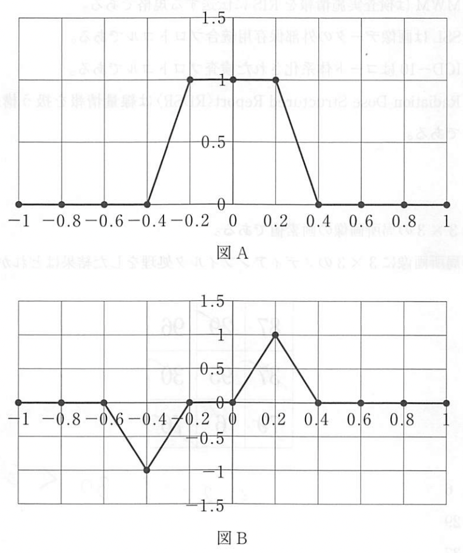{width=7cm} 1.  微分フィルタ 2.  加重平均フィルタ 3.  平均フィルタ 4.  メディアンフィルタ 5.  アンシャープマスキングフィルタ   問03. 図の局所画像に3×3 メディアンフィルタを適用した結果はどれか。 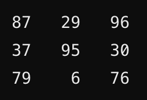{width=7cm} 1.  6 2.  29 3.  37 4.  76 5.  87   問04. アナログ信号をデジタル化する際に用いるアンチエイリアシングフィルタの効果で正しいのはどれか。 1.  画像を鮮鋭化させる 2.  直流成分を減衰させる 3.  濃度分解能を向上させる 4.  標本化周波数以上の空間周波数成分を増加させる 5.  nan   問05. 5 × 5 の画素値の分布 A に対して 3 × 3 の空間フィルタ F を作用させた。フィルタ処理後の画素値 $a_{ij}(i=3,j=3)$で正しいのはどれか。 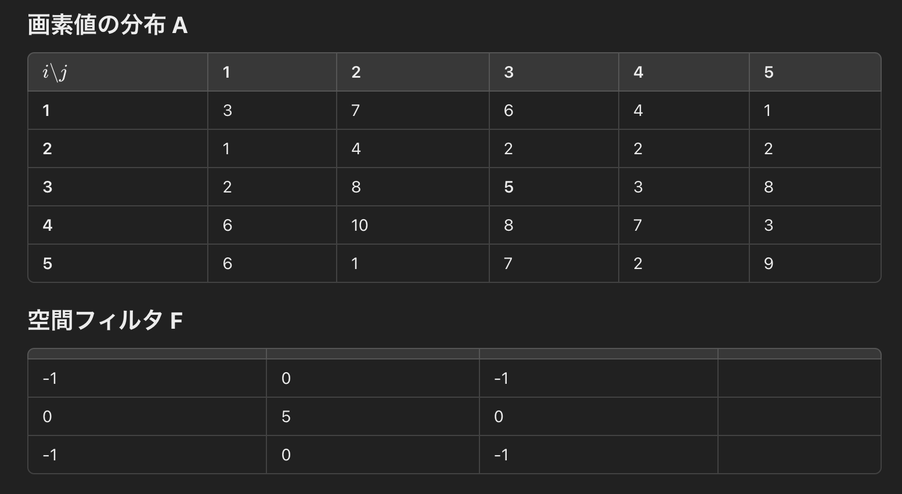{width=7cm} 1.  1 2.  2 3.  3 4.  4 5.  5   問06. エッジ検出フィルタとして正しいのはどれか。 2つ選べ。 1.  ガウシアンフィルタ 2.  ソーベルフィルタ 3.  バターワースフィルタ 4.  メディアンフィルタ 5.  ラプラシアンフィルタ   問07. 画素値のヒストグラムから直接求められない特徴量はどれか。 1.  分散 2.  歪度 3.  期待値 4.  鮮鋭度 5.  中央値   問08. 階調処理はどれか。 1.  ボケマスク処理 2.  トレンド除去処理 3.  ヒストグラム平坦化処理 4.  メディアンフィルタ処理 5.  リージョングローイング処理   問09. 異なるモダリティ間の画像融合で正しいのはどれか。 1.  差分画像を用いる 2.  加算画像を用いる 3.  相互情報量を用いる 4.  畳み込み演算を行う 5.  反転画像を用いる   問10. 異なるモダリティ間の画像融合で正しいのはどれか。 1.  差分画像のピクセル和を最小化する 2.  縦横比を揃える 3.  ピクセルスケールを一致させる 4.  相互情報量を最大化する 5.  画像中心を合わせる   問11. 画像融合に用いられるものはどれか。二つ選べ。 1.  回転変換 2.  並進変換 3.  ゲージ変換 4.  ヤコビ変換 5.  ローレンツ変換   問12. 画像融合で正しい記述はどれか。 1.  画像間の一致度を表す関数を定義し、それが最大となる座標変換を行う 2.  画像間の不一致度を表す関数を定義し、それが最大となる座標変換を行う 3.  画像間の一致度を表す関数を定義し、それが最大となるようにピクセル値を補正する 4.  画像間の不一致度を表す関数を定義し、それが最大となるようにピクセル値を補正する 5.  画像間の一致度を表す関数を定義し、それが最小となるようにピクセル値を補正する   問13. 画像融合で正しい記述はどれか。 1.  異なるモダリティの画像は使えない 2.  事前にフィルタ処理を行ってはいけない 3.  DICOMヘッダーに記載の座標を一致させる 4.  画像の一致度に関する最適化問題に帰着させる 5.  画像融合に使う変数はピクセル値である   問14. 画像レジストレーションに使われる画像類似度指標はどれか。2 つ選べ。 1.  固有値 2.  尖度 3.  相互相関係数 4.  四分位範囲 5.  相互情報量   問15. 鮮鋭化フィルタとして最も適切なものはどれか。 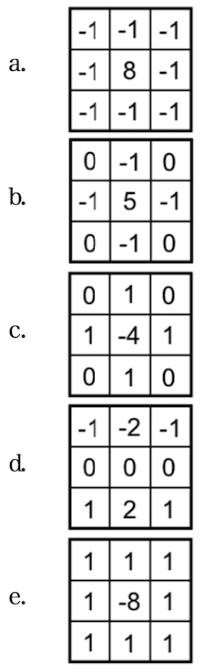{width=3.5cm} 1.  a 2.  b 3.  c 4.  d 5.  e   問16. 離散ウェーブレット変換を用いる圧縮はどれか。 1.  DICOM 2.  GIF 3.  JPEG2000 4.  MPEG4 5.  AAC   問17. 図の画像にx, y方向それぞれの3×3 Sobelフィルタを適用した結果はどれか。２つ選べ。 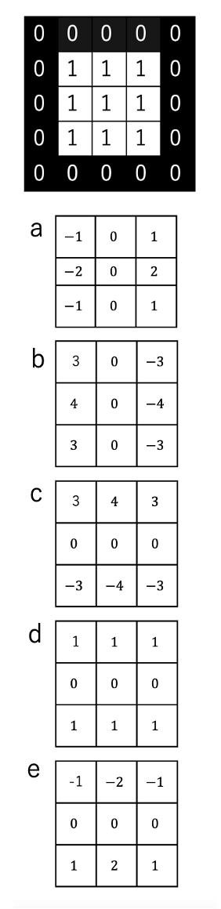{width=3.5cm} 1.  a 2.  b 3.  c 4.  d 5.  e   問18. 図の画像に3×3 Laplacianフィルタを適用した結果はどれか。 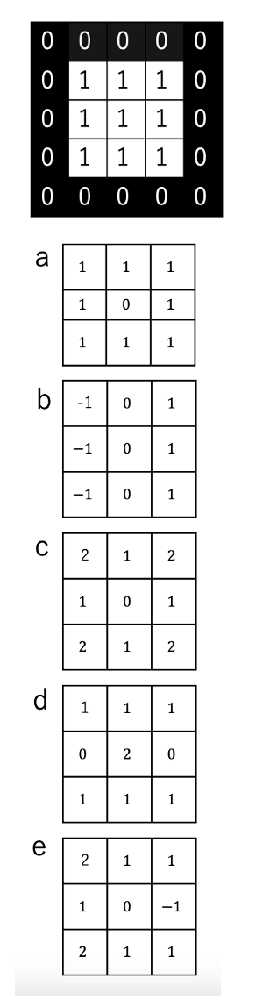{width=3.5cm} 1.  a 2.  b 3.  c 4.  d 5.  e   問19. 図の画像に図に示す3×3 フィルタを適用した結果はどれか。 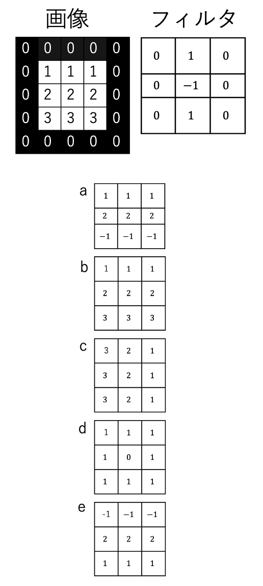{width=3.5cm} 1.  a 2.  b 3.  c 4.  d 5.  e   問20. 図の画像に図に示す3×3 メディアンフィルタを適用した結果はどれか。 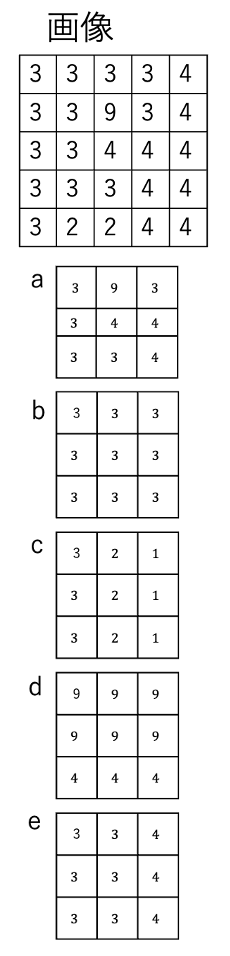{width=3.5cm} 1.  a 2.  b 3.  c 4.  d 5.  e   問21. 図に 1 次元フィルタ (-1, 0, 1) で畳み込み処理したものは次のうちどれか。 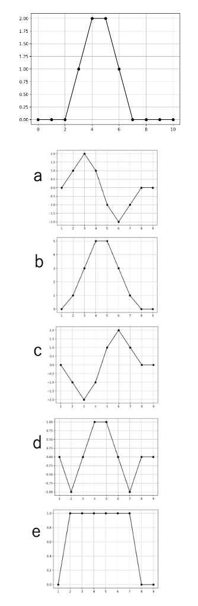{width=3.5cm} 1.  a 2.  b 3.  c 4.  d 5.  e   問22. 図に平均化フィルタで畳み込み処理したものは次のうちどれか。 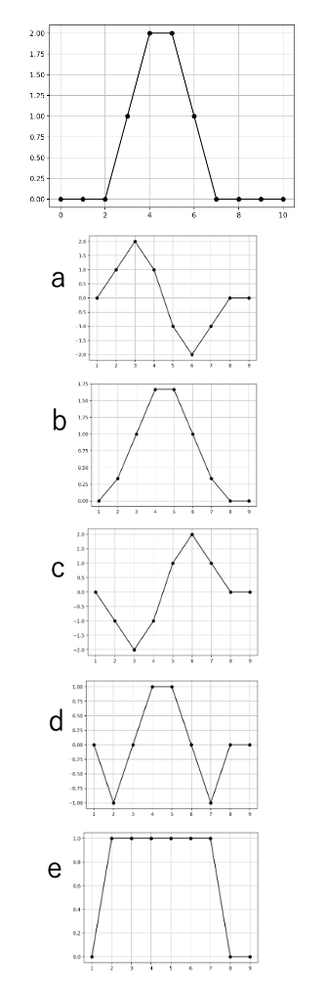{width=3.5cm} 1.  a 2.  b 3.  c 4.  d 5.  e   問23. 二値化処理で使われる手法はどれか。 1.  離散コサイン変換 2.  モード法 3.  ウィンドウ処理 4.  p-タイル法 5.  サーフェースレンダリング法   問24. エッジ強調に使われる手法はどれか。二つ選べ。 1.  ボケマスク処理 2.  オープニング処理 3.  クロージング処理 4.  鮮鋭化処理 5.  平滑化処理   問25. ノイズ除去を目的として使われる手法はどれか。二つ選べ。 1.  メディアンフィルタ処理 2.  リカーシブフィルタ処理 3.  二値化処理 4.  画像融合 5.  非可逆圧縮   問26. 画像圧縮に\underline{関連しないもの}はどれか。 1.  ランレングス符号化 2.  ハフマン符号化 3.  離散ウェーブレット変換 4.  基底関数展開 5.  ウィンドウ処理   問27. 画像圧縮に関連するものはどれか。 1.  エネルギーサブトラクション 2.  画像レジストレーション 3.  ボリュームレンダリング 4.  変換符号化 5.  MIP処理   問28. 正しいものはどれか。 1.  信号を正確に再構成するためには、サンプリング周波数は信号の最大周波数の1/2以上でなければならない。 2.  標本化定理は、連続信号をデジタル信号に変換する際にエイリアシングを防ぐための理論である。 3.  サンプリング周波数が元の信号の最大周波数よりも高い場合でも、エイリアシングが必ず発生する。 4.  ナイキスト周波数とは、サンプリング周波数の2倍に相当する周波数である。 5.  標本化定理はアナログ信号に対する定理である。   問29. 標本化定理で正しい関係式はどれか。ここで$f_{max}$は信号の周波数の最大値、$f_s$はサンプリング周波数である。 1.  $f_s > f_{max}$ 2.  $f_s < f_{max}$ 3.  $f_s > 2 f_{max}$ 4.  $f_s < 2 f_{max}$ 5.  $f_s = f_{max}$   問30. 画像表示が変わるだけで、元の画像は変わっていないものはどれか。 1.  ヒストグラム平坦化 2.  ダイナミックレンジ圧縮 3.  バンドパスフィルタ処理 4.  非剛体変換処理 5.  ウィンドウ処理   問31. ２つの画像の相互情報量について適切な記述はどれか。 1.  画像レジストレーションでは最小化される 2.  PET-CTで使われる 3.  ユークリッド距離と一致する 4.  ２つの画像が独立の時、1となる 5.  相互相関係数が最大の時、相互情報量も最大となる   問32. ２つの画像の相互相関係数について適切なものはどれか。二つ選べ。 1.  最大値は1, 最小値は-1となる 2.  異なるモダリティ画像で積極的に使われる 3.  画像レジストレーションでは最大となる座標変換を探す 4.  最小値の時、２つの画像が一致する 5.  ユークリッド距離と一致する   問33. 非可逆圧縮形式はどれか。 1.  PNG 2.  DICOM 3.  JPEG 4.  JPEG2000 5.  Lossless JPEG   問34. 画像のヒストグラム平坦化処理で正しい記述はどれか。 1.  原画像のヒストグラム形状は保存する 2.  全ての信号値の生起確率が1となる 3.  処理後のヒストグラムの累積確率分布が直線となる 4.  ノイズ除去が目的である 5.  信号値の最大値は255となる   問35. 図Aは3×3の局所画像の画素値である。この局所画像に図Bに示す3×3の加重平均フィルタ処理をしたときの目的画素の値はどれか。 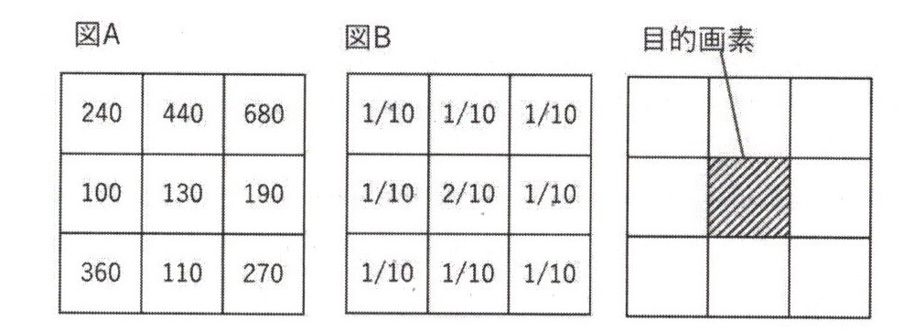{width=7cm} 1.  130 2.  240 3.  252 4.  265 5.  280   問36. 画像コントラストを高める階調処理はどれか。2つ選べ。 1.  2値化処理 2.  ウィンドイング処理 3.  ヒストグラム平坦化処理 4.  平滑化フィルタ処理 5.  モルフォロジカルフィルタ処理   問37. ノイズ低減を目的とした画像間演算はどれか。 1.  ボケマスク処理 2.  マルチ周波数処理 3.  リカーシブルフィルタ処理 4.  経時サブトラクション処理 5.  エネルギーサブトラクション処理   問38. ノイズ低減効果のあるフィルタはどれか。2つ選べ。 1.  ソーベルフィルタ 2.  ローパスフィルタ 3.  ハイパスフィルタ 4.  メディアンフィルタ 5.  ラプラシアンフィルタ   