# 2025年度医用画像情報学II（後期）

# 演習問題

問01. 図の中で CR 画像読み取り装置に用いられている log アンプの電圧入出力特性を示しているのはどれか。ただし、$V_{in}$ は入力電圧、$V_{out}$ は出力電圧、グラフは横軸・縦軸ともリニアスケールとする。 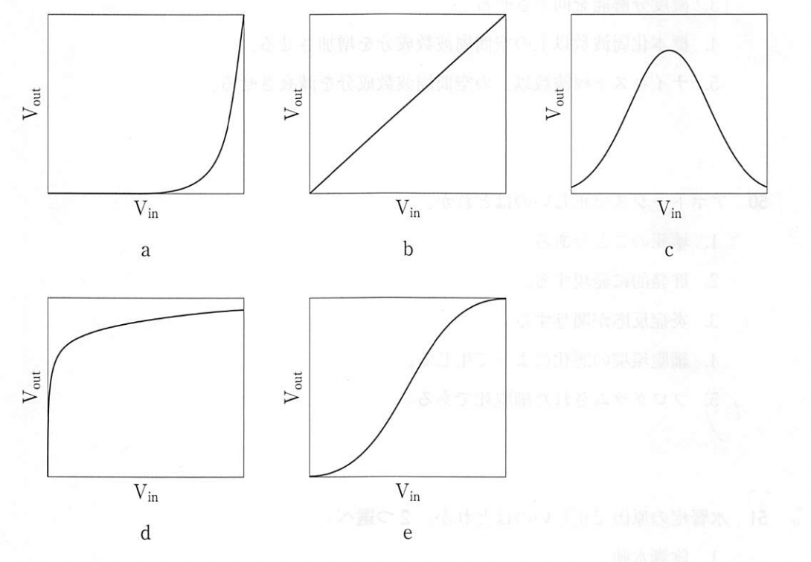{width=7cm} 1.  a 2.  b 3.  c 4.  d 5.  e   問02. 特性曲線を距離法で作成したい。X線管焦点フィルム間距離360 cmを基準としたとき、$\log_{10} RE$（relative exposure）が0.6となるところのX線管焦点フィルム間距離[cm]はどれか。ただし、$\log_{10} 2$ = 0.3 とする。 1.  60 2.  90 3.  180 4.  270 5.  720   問03. あるデジタルX線画像システムで撮影した時の、単位面積1mm$^2$当たりの平均入射X線量子数が1,000個で、出力画像のSNRは20であった。このシステムのDQEの値はいくらか。 1.  0.2 2.  0.3 3.  0.4 4.  0.5 5.  0.6   問04. 焦点検出器間距離を100cmから120cmに変え、その他の条件を同一にしてX線撮影を実施した。受像面のX線量の倍数で最も近い値はどれか。 1.  0.69 2.  0.83 3.  1.2 4.  1.44 5.  2   問05. ROC解析で正しいものはどれか。 1.  ROC曲線の横軸は真陽性率である。 2.  ROC曲線下の面積の最大値は0.5である。 3.  ROCの解析結果は物理的評価と一致する。 4.  ROC曲線は信号コントラストの高低に影響されない。 5.  ROC曲線間の統計的有意差検定にJackknife法が用いられる。   問06. デジタルX線画像における雑音に最も影響を及ぼす因子はどれか。 1.  画像の輝度 2.  画像の彩度 3.  焦点サイズ 4.  後方散乱係数 5.  X線量子モトル   問07. 図のような周期パターンのMichelson（マイケルソン）コントラストはどれか。 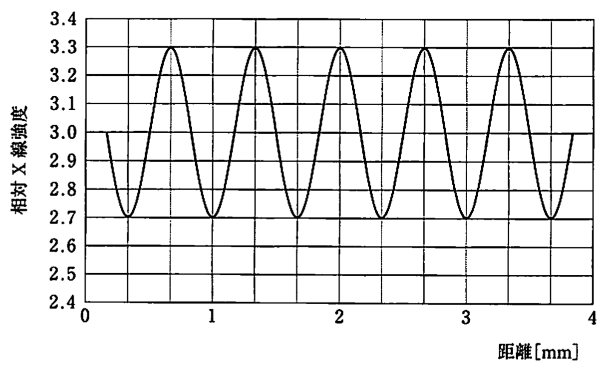{width=7cm} 1.  0.1 2.  0.6 3.  1.2 4.  2.7 5.  3.3   問08. エッジ法によるプリサンプルドMTFで正しいのはどれか。 1.  単位はmm$^2$である 2.  ESFのトレンド補正をする 3.  LSFはESFを微分して得る 4.  LSFのパワースペクトルである。 5.  金属エッジを画素列に対して15度傾けて撮影する。   問09. X 線画像の被写体コントラストに大きく影響するのはどれか。 2 つ選べ。 1.  撮影時間 2.  検出器の入出力特性 3.  入射 X 線のスペクトル 4.  被写体に入射する光子数 5.  検出器に入射する散乱線   問10. X 線写真のウィナースペクトルについて正しいのはどれか。 1.  体積の次元を持つ。 2.  X 線量が少ないほど値が小さくなる。 3.  高空間周波数領域は量子モトルに影響される。 4.  値が大きいほど低コントラスト信号の検出能は優れる。 5.  濃度変動をフーリエ変換しその絶対値を 2 乗して求める。   問11. 解像力チャートの像に対応する空間周波数［cycles/mm］に最も近いのはどれか。 1.  0.3 2.  0.6 3.  1.2 4.  1.6 5.  3.2   問12. 図の ROC 曲線で、雑音のみの確信度正規分布の標準偏差が信号ありの確信度正規分布の標準偏差より小さいときの曲線はどれか。 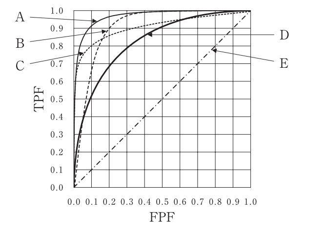{width=7cm} 1.  A 2.  B 3.  C 4.  D 5.  E   問13. 血管造影検査で焦点寸法が 0.3 mm のX線管を用いて焦点受像器間距離を 100cm として X 線撮影を行った。造影目的の血管が受像器か ら 20 cm 焦点側にあるとき、この血管の幾何学的不鋭（半影）の大きさ[μm]に最も近いのはどれか。 1.  15 2.  25 3.  35 4.  50 5.  75   問14. 空間周波数cycles/mm の MTF が 0.4 である画像システムがある。このシステムに空間周波数cycles/mm で平均10、振幅3の正弦波が入力されたとき、出力される平均 10 の正弦波の振幅はどれか。 1.  0.4 2.  0.8 3.  1 4.  1.2 5.  2   問15. 図に検出器システム AーE の MTF と Wiener（ウィナースペクトル）を示す。
階調度が一定のとき、高周波領域の NEQ が最も高いのはどれか。 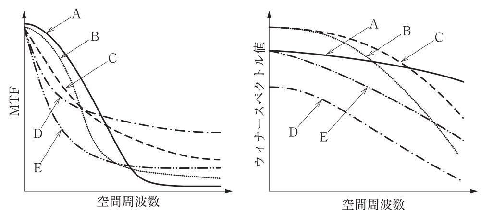{width=7cm} 1.  A 2.  B 3.  C 4.  D 5.  E   問16. X 線受像器に単位面積当たりに平均 Φ 個の光子が入射したとき、被写体コントラストが C、断面積 A のオブジェクトの X 線投影像を人の眼で識別するために必要な最小の SNR を与える式はどれか。ただし、量子雑音はポアソン分布に従うものとし、それ以外の雑音は無視する。 1.  $\frac{C}{A\phi}$ 2.  $\frac{C}{\sqrt{A\phi}}$ 3.  $C\sqrt{A\phi}$ 4.  $\sqrt{CA\phi}$ 5.  $CA\sqrt{\phi}$   問17. ROC 解析について正しいのはどれか。 1.  信号が見えやすい画像を選んで用いる。 2.  ｢1-偽陽性率｣で真陰性率が求められる。 3.  観察者は信号有無の確信度と位置を答える。 4.  先に雑音のみの画像を観察しその後信号ありの画像を観察する。 5.  信号有無の確信度の両正規分布が完全に重なったとき AUC1曲線下面積3は _x0004_になる。   問18. スリット法で測定した CR システムのプリサンプリング MTF を図に示す。 高空間周波数領域で MTF が上昇している原因として考えられるのはどれか。 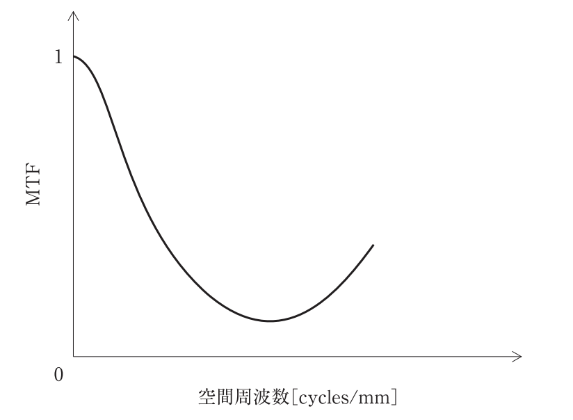{width=7cm} 1.  階調処理が影響した。 2.  有効露光量変換を行わなかった。 3.  イメージングプレートが劣化していた。 4.  量子モトルによる雑音が強く影響した。 5.  金属スリット長軸を画素列と平行にした。   問19. 検出系に全くボケがない理想的な画像システムの量子雑音 n(x)を図 A に示す。
図 B にこの雑音の自己相関関数 Φ(r)と振幅パワースペクトル F(u)を示す。
ア-オの組合せで正しいのはどれか。 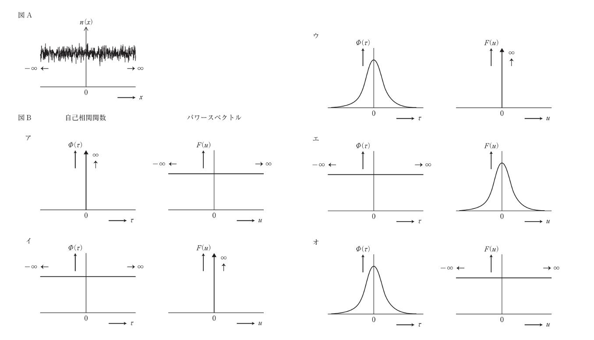{width=7cm} 1.  ア 2.  イ 3.  ウ 4.  エ 5.  オ   問20. 図の ROC 曲線について正しいのはどれか。 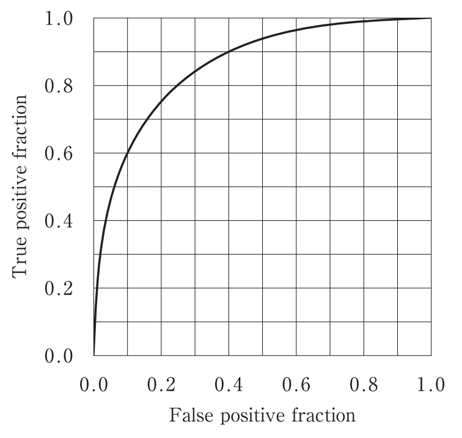{width=7cm} 1.  感度 80％の時の特異度は 25％である。 2.  偽陽性率が 0.1 のとき真陰性率は 0.6 である。 3.  両正規確率紙に転記すると傾き2の直線になる。 4.  信号検出能が向上すると曲線は右下へシフトする。 5.  曲線の信号ありと雑音のみの確信度正規分布の分散は等しい。   問21. 図のように厚さ x[cm]の水ファントム(背景)の中に直径 d[cm]の球状の気泡が ある。この水ファントムに光子フルエンス $\phi_0$ の一様な X 線を入射させたとき、背景を透過した光子フルエンスを $\phi_1$、気泡の中心を透過した光子フルエンスを $\phi_2$ とする。背景に対するこの気泡の被写体コントラスト C を$(\phi_2-\phi_1)/\phi_1$で定義するとき、C を表す式で正しいのはどれか。ただし、この入射光子エネルギーに対する水の線減弱係数を μ[cm$^{-1}$]とし、気泡中の光子の減弱は考えない。また、散乱線の寄与は無視する。 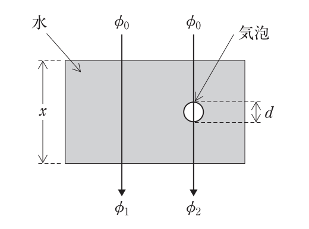{width=7cm} 1.  $e^{\mu d}-1$ 2.  $1-e^{-\mu d}$ 3.  $1-e^{\mu (x- d)}$ 4.  $e^{\mu (x- d)}-1$ 5.  $1-e^{-\mu (x- d)}$   問22. 図のような3個の線形シフト不変システムが連結された画像システムがある。空間周波数 2.0 cycles/mm におけるシステム1、システム2及びシステム全体のMTF 値がそれぞれ 0.7、 0.7 及び 0.2 であるとき、システム3の 2.0 cycles/mmにおける MTF 値に最も近いのはどれか。 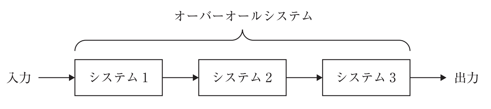{width=7cm} 1.  0.2 2.  0.3 3.  0.4 4.  0.5 5.  0.7   問23. アパーチャ幅 d のデジタル検出器の幅方向の MTF(u)を表す式はどれか。ただし、検出器応答は完全な矩形関数で与えられるものとし、幅方向の空間周波数を u; u ≧0とする。 1.  $\frac{1}{2\pi u d} |\sin{\frac{\pi u d}{2}}|$ 2.  $\frac{1}{\pi u d} |\sin{\pi u d}|$ 3.  $\frac{2}{\pi u d} |\sin{\pi u d}|$ 4.  $\frac{d}{pi u} |\sin{\frac{\pi u}{d}}|$ 5.  $\frac{1}{\pi u} |\sin{\pi u d}|$   問24. X 線 CT 再構成画像の Wiener(ウィナー)スペクトルの特徴で正しいのはどれか。 1.  直流成分は原理的に0になる。 2.  再構成アルゴリズムの影響を受けない。 3.  曲線下の面積は検出器入射線量に比例する。 4.  空間周波数の増大とともに単調に減少する。 5.  測定は投影データを二次元 Fourier(フーリエ)変換する。   問25. デジタル撮影システム A と B のデジタル特性曲線を図に示す。システムの特性として正しいのはどれか。 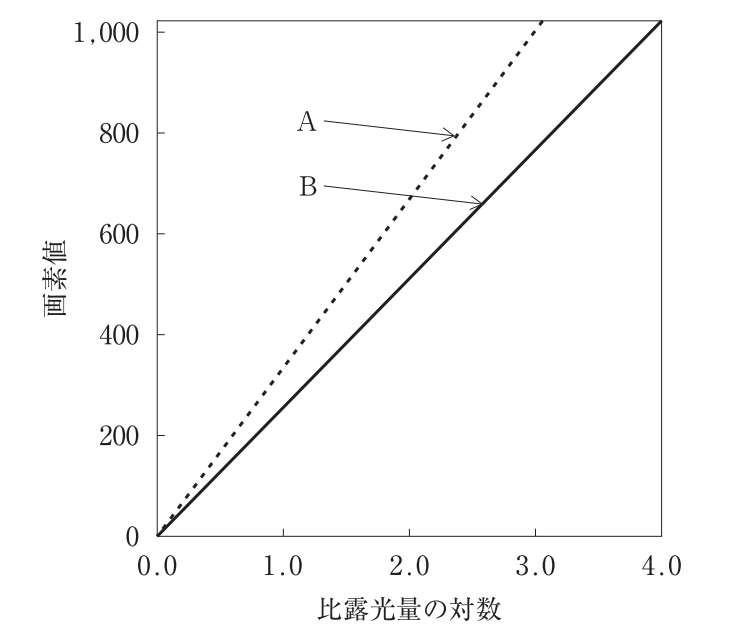{width=7cm} 1.  MTF は A の方が高い。 2.  X 線コントラストは B の方が高い。 3.  ダイナミックレンジは A の方が広い。 4.  比露光量の対数が 2.0 の時のグラディエントは B の方が高い。 5.  同じ被検体を撮影した場合の画像コントラストは A の方が高い。   問26. 信号および雑音からなる試料と雑音のみの試料を観察して得られた、確信度の確率密度分布を図に示す。上が信号および雑音、下が雑音のみの分布である。しきい値を T としたとき、TNF を表す領域は図中のどれか。なお、A から D は、曲線下面積を表すものとする。 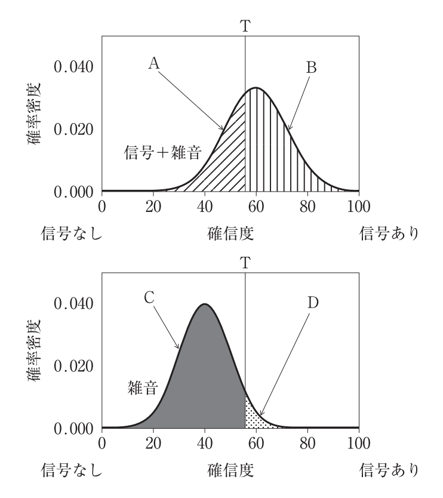{width=7cm} 1.  A 2.  C 3.  D 4.  A+C 5.  B+D   問27. X 線画像の評価で正しいのはどれか。2つ選べ。 1.  被写体のコントラストが上昇すれば解像力は低下する。 2.  ROC 解析は読影者間の能力の差を評価することができる。 3.  RMS 粒状度はフィルム濃度の変動を標準偏差値で表している。 4.  解像力は 1/4d cycles/mm である。d：分離不能になった細線の幅 5.  X 線撮影系の MTF 評価では 10 cycles/mm の特定空間周波数がよく用いら れる。   問28. X 線受像器の1画素当たりに検出される全光子数の 50％が散乱光子の場合、散乱線の寄与による出力信号の SN 比の損失割合に最も近いのはどれか。ただし、散乱線は Poisson(ポアソン)分布に従う付加雑音として検出されるものとする。 1.  0.1 2.  0.25 3.  0.3 4.  0.5 5.  0.7   問29. デジタル X 線画像検出器のアパーチャ MTF を図に示す。検出器の開口幅[mm]はどれか。 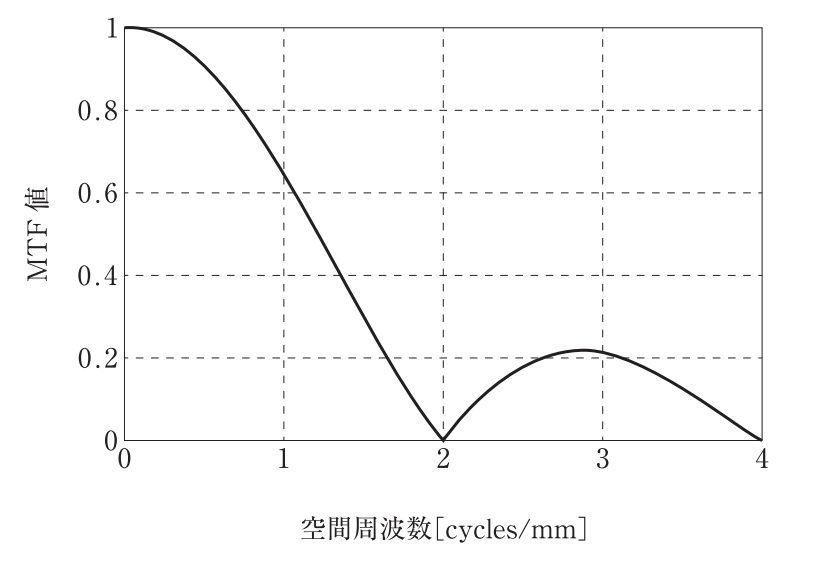{width=7cm} 1.  0.25 2.  0.5 3.  1 4.  2 5.  4   問30. デジタル X 線画像システムの画質特性を表す指標で、値が低いほど低コントラスト分解能が高いのはどれか。 1.  CNR 2.  DQE 3.  MTF 4.  NEQ 5.  NPS   問31. 刺激安反応行列を図に示す。陽性的中率はどれか。 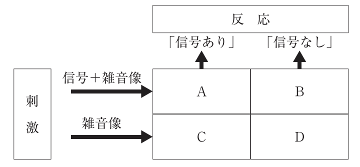{width=7cm} 1.  A/(A+B) 2.  A/(A+C) 3.  A/(A+D) 4.  A(A+B+C) 5.  A(A+B+C+D)   問32. DQE で正しいのはどれか。 1.  面積の次元を持つ。 2.  X 線光子の利用効率を表す。 3.  NEQ と入射光子数との積である。 4.  出力画像の SN 比の乗に対応する。 5.  同一の値であれば解像特性は等しい。   問33. 等方ボクセル化された3次元画像から観察対象の表面情報のみを表示する手法はどれか。 1.  加算投影法 2.  最大値投影法 3.  多断面再構成法 4.  ボリュームレンダリング法 5.  サーフェイスレンダリング法   問34. 物体表面に陰影処理を施して立体感を表現する三次元表示法はどれか。2つ選べ。 1.  最小値投影法 2.  最大値投影法 3.  多断面変換表示法 4.  ボリュームレンダリング法 5.  サーフェイスレンダリング法   問35. 写真濃度が2.0となる組み合わせで正しいのはどれか。 1.  入射光量100-透過光量1 2.  入射光量100-透過光量10 3.  入射光量100-透過光量90 4.  入射光量10-透過光量100 5.  入射光量90-透過光量100   問36. 人の目で見える光＜可視光＞で誤っているのはどれか。 1.  電磁波の一種である 2.  錐体細胞で波長別に感知される。 3.  桿体細胞で電気信号に変換される 4.  波長はおよそ80 mmから370 mm である。 5.  波長によって人間の感じる色は違ってくる。   問37. デジタルX線画像における入力特性として正しいのはどれか。 1.  入力信号は常に線形で増幅される。 2.  入力信号には検出器の感度や量子モトルが影響する。 3.  入力信号は観察者の視覚特性に依存する。 4.  入力特性はガンマ補正によって決まる。 5.  入力特性は表示モニタの階調数によって変化する。   問38. デジタル画像の出力特性に関して正しい記述はどれか。 1.  出力特性は検出器のDQE（Detective Quantum Efficiency）で規定される。 2.  出力特性は視覚系の分解能を含まない。 3.  出力特性にはモニタの輝度や階調特性が関与する。 4.  出力特性はX線量子の吸収効率に依存する。 5.  出力特性は常に線形であり補正は不要である。   問39. デジタル X 線画像検出器のアパーチャ MTF を図に示す。検出器の開口幅[mm]はどれか。 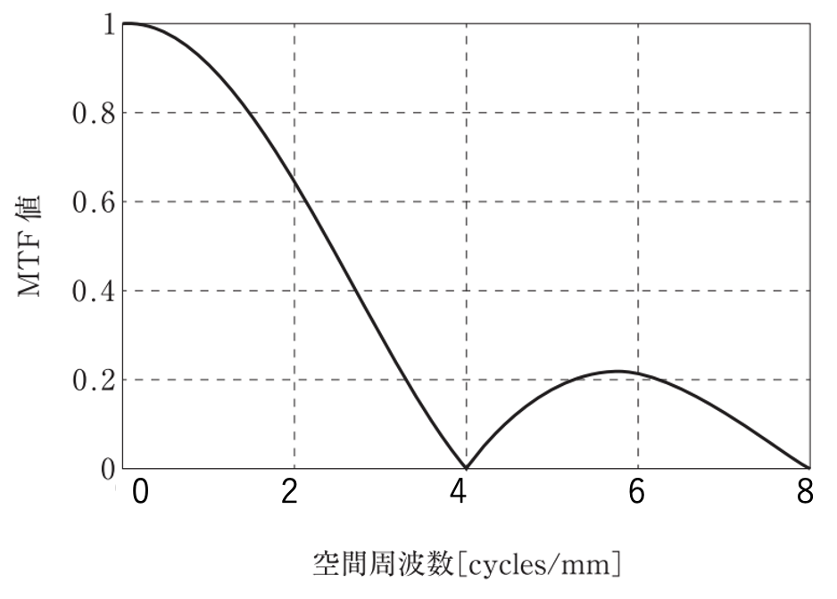{width=7cm} 1.  0.25 2.  0.5 3.  1 4.  2 5.  4   問40. デジタル X 線画像検出器のアパーチャ MTF を図に示す。検出器の開口幅[mm]はどれか。 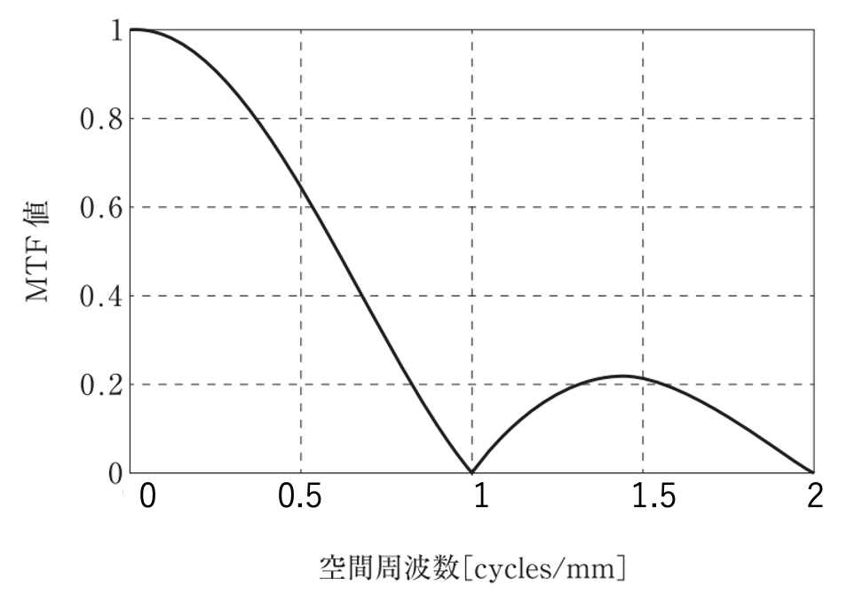{width=7cm} 1.  0.25 2.  0.5 3.  1 4.  2 5.  4   問41. MTF（Modulation Transfer Function）について正しいのはどれか。 1.  画像の雑音特性を示す。 2.  検出器の空間分解能を周波数領域で表す。 3.  量子検出効率を示す。 4.  視覚特性に依存する。 5.  入力線量に依存して変化する。   問42. DQE（Detective Quantum Efficiency）について正しいのはどれか。 1.  MTF と SNR の両方が関与する指標である。 2.  画像の空間周波数とは無関係である。 3.  入力線量を増加させると必ず大きくなる。 4.  単位は mm$-{-1}$で表される。 5.  入力信号のMTFのみで定義される。   問43. 高DQEを有するX線検出器の利点として正しいのはどれか。 1.  被写体コントラストが上昇する。 2.  ノイズ特性が改善され、少ない線量でも画像品質を維持できる。 3.  MTFが必ず向上する。 4.  画像の階調特性が改善される。 5.  検出器の画素サイズが大きくなる。   問44. SNR、MTF、DQEの関係について正しいのはどれか。 1.  DQEはSNRの二乗比で定義される。 2.  MTFが高ければ必ずDQEも高い。 3.  入力線量を増加させるとDQEは比例的に増加する。 4.  SNRは空間周波数に依存しない。 5.  DQEは単位 [mm$^{-1}$] で表される。   問45. ディジタルX線画像系において、検出量子効率（DQE）に関する記述で正しいのはどれか。 1.  DQE(f) は、入射線量子数には依存せず、MTFとNPSから算出される。 2.  DQE(f) は、入射線量子数が増加すると常に減少する。 3.  DQE(f) = NPS(f) / MTF(f)$^2$ で表される。 4.  DQE(f) は、出力画像のSNRと入力線量子数の比を表す。 5.  DQE(f) は、低周波数域では必ず 0 になる。   問46. Noise Power Spectrum（NPS）に関する記述で正しいのはどれか。 1.  NPSは出力画像のノイズの空間周波数特性を表す。 2.  NPSはWiener spectrumとも呼ばれる。 3.  NNPSはNPSを平均信号値$^2$で正規化したものである。 4.  DQE算出にはNPSが必須である。 5.  上記すべてが正しい。   