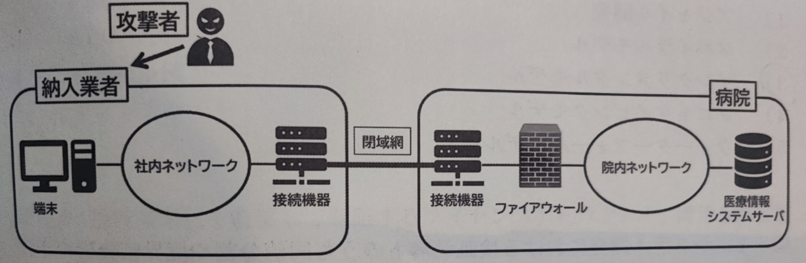
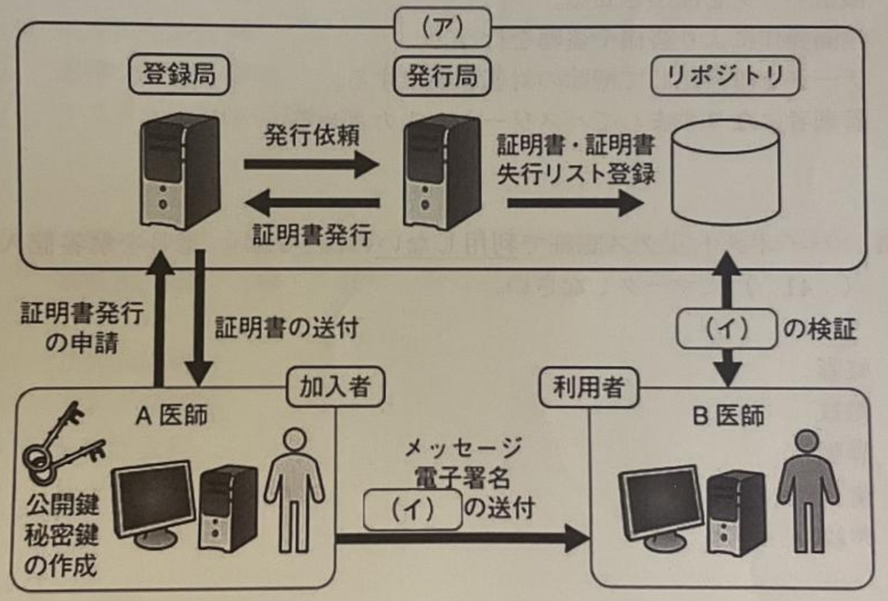

# 2025年度医用画像情報学II（後期）

# 演習問題

問01.  データの暗号化を行い解除キーの代わりに金銭を要求する不正プログラムはどれか。
 1.   ランサムウェア
 2.   ボット
 3.   アドウェア
 4.   スパイウェア
 5.   キーロガー
   問02.  情報セキュリティの３要素（CIA）に含まれるのはどれか。
 1.   完全性
 2.   見読性
 3.   真正性
 4.   信頼性
 5.   責任追跡性
   問03.  個人情報入力が必要なWebサイトで安全な通信を実現するために利用されるプロトコルはどれか。
 1.   DES
 2.   OTP
 3.   UDP
 4.   VPN
 5.   SSL/TLS
   問04.  デジタル署名で検知できるものはどれか。
 1.   盗聴
 2.   改ざん
 3.   漏えい
 4.   ウィルス感染
 5.   不正アクセス
   問05.  共通鍵暗号方式について正しいものはどれか。
 1.   電子署名に利用される
 2.   暗号化と復号で鍵が異なる
 3.   受信者が送信者の秘密鍵で暗号化する
 4.   通信相手ごとに異なる鍵で暗号化する
 5.   公開鍵方式より暗号化アルゴリズムが複雑である
   問06.  問い合わせ高速化の仕組みを悪用して不正なドメインにアクセスさせる攻撃はどれか。
 1.   DDoS
 2.   DDNS
 3.   SQLインジェクション
 4.   DNSキャッシュポイズニング
 5.   クロスサイトスクリプティング
   問07. 情報システム部門の担当者になりすました電話により、システムにログインするためのIDとパスワードを聞き出す手法はどれか。 1.  DoS攻撃 2.  ゼロデイ攻撃 3.  総当たり攻撃 4.  パスワードクラック 5.  ソーシャルエンジニアリング   問08. 人による偶発的脅威に分類されるのはどれか。 1.  盗難 2.  落雷 3.  悪意のある操作 4.  システムのハッキング 5.  USBメモリの置き忘れ   問09. 情報セキュリティの3要素のうち、権限を有する者だけに、許可された範囲内で情報の読み書きを可能とするのはどれか。 1.  可用性 2.  完全性 3.  機密性 4.  真正性 5.  責任追及性   問10. リスクマネジメントにおいて、リスクの影響を受ける可能性のある関係者同士で、リスクに関する情報を交換・共有するプロセスはどれか。 1.  リスク対応 2.  モニタリング 3.  組織の状況の確定 4.  リスクアセスメント 5.  リスクコミュニケーション   問11. 公開鍵暗号方式の電子署名の復号に用いるのはどれか。 1.  受信者の公開鍵 2.  受信者の秘密鍵 3.  送信者の公開鍵 4.  送信者の秘密鍵 5.  タイムスタンプ   問12. コンピュータ内のデータを暗号化して解読不能にしたうえで、暗号化解除の対価を要求するメッセージを表示するマルウェアはどれか。 1.  ワーム 2.  バックドア 3.  トロイの木馬 4.  スパイウェア 5.  ランサムウェア   問13. 通信事業者の閉域型ネットワークを介して構築されるVPN通信はどれか。 1.  L2TP 2.  PPTP 3.  IP-VPN 4.  SSL-VPN 5.  IPsec-VPN   問14. 停電の際に、一定時間、電源の供給を行う装置はどれか。 1.  EPS 2.  PLC 3.  PoE 4.  UPS 5.  WPA   問15. データをバックアップする方法のうち、論理的な単位ではなく、記憶装置上のビット列全体をそのまま複製するのはどれか。 1.  差分バックアップ 2.  フルバックアップ 3.  イメージのバックアップ 4.  オフラインバックアップ 5.  ファイルのバックアップ   問16. ネットワークの性能に関する指標で、通信容量に対して、実際にデータ転送に使用されている割合を表すのはどれか。 1.  回線利用率 2.  CPU使用率 3.  往復遅延時間 4.  ビット誤り率 5.  レスポンスタイム   問17. 本番系と同じ構成の待機系を稼働状態にしておき、障害時は待機系が自動で処理を引き継いて業務を継続する方式はどれか。 1.  デュアルシステム 2.  ホットスタンバイ 3.  ウォームスタンバイ 4.  コールドスタンバイ 5.  シンプレックスシステム   問18. コンピュータ上で試験を行うことに特化した仕組みで、出題、採点、解説、表示などの機能があるのはどれか。 1.  СВТ 2.  CMS 3.  GIO 4.  OJT 5.  SBOs   問19. 情報セキュリティの3要素の組み合わせについて正しいのはどれか。 1.  機密性-安全性-可用性 2.  機密性-完全性-可用性 3.  真正性-安全性-可用性 4.  真正性-完全性-可用性 5.  真正性-機密性-可用性   問20. リスクマネジメントにおいてリスクを発見、確認および記録するプロセスはどれか。 1.  リスク対応 2.  リスク特定 3.  リスク評価 4.  リスク分析 5.  リスク保有   問21. 情報セキュリティ対策のなかの物理的対策にあたるのはどれか。 1.  入退室管理 2.  アクセス権の設定 3.  セキュリティ教育 4.  ファイアウォールの設定 5.  セキュリティポリシーの策定   問22. SSL/TLSに関する記述として適切なのはどれか。 1.  通信を高速化する。 2.  通信データの暗号化を行う。 3.  不正な通信を遮断して通知する。 4.  公的認証機関が通信を中継する。 5.  通信データの改ざんを検出して通知する。   問23. DoS攻撃についての説明はどれか。 1.  データを改ざんする攻撃 2.  サービスを不正利用する攻撃 3.  データを不正に取得する攻撃 4.  サーバを過負荷状態にする攻撃 5.  サーバの管理者権限を奪取する攻撃   問24. 公開鍵基盤(PKI)における認証局(CA)の役割として正しいのはどれか。 1.  電子証明書の発行 2.  加入者の秘密鍵の発行 3.  利用者の公開鍵の発行 4.  メッセージの改ざん検出 5.  メッセージへの電子署名   問25. 本人確認の多要素認証の組み合わせとして適切なのはどれか。 1.  氏名と生年月日 2.  指紋認証と顔認証 3.  暗証番号と秘密の質問 4.  職員証ICカードとパスワード 5.  メールアドレスとパスフレーズ   問26. 図のように攻撃者が納入業者側のシステムを介して病院の医療情報システムに侵入・攻撃することを表すのはどれか。 {width=7cm} 1.  スパイウェア 2.  ランサムウェア 3.  サプライチェーン攻撃 4.  ブルートフォース攻撃 5.  SQLインジェクション   問27. 接続端末数を監視して制限するライセンス契約はどれか。 1.  コアライセンス契約 2.  サイトライセンス契約 3.  サブスクリプション契約 4.  ボリュームライセンス契約 5.  デバイスクライアントアクセスライセンス契約   問28. コールドスタンバイの説明はどれか。 1.  障害発生時に自動的にシステムを停止すること 2.  地理的に離れた場所にバックアップデータを保管すること 3.  本番系と同一構成の予備システムを停止状態で待機させること 4.  障害発生時には一部機能を停止し、最小限の機能を維持すること 5.  本番系と同一構成の予備システムを常に同期をとった状態で待機させること   問29. 情報システムの運用管理におけるPDCAサイクルのうち「D」にあたるのはどれか。 1.  教育の実施 2.  パフォーマンス評価 3.  マネジメントの計画 4.  問題個所の是正、改善 5.  セキュリティポリシーの見直し   問30. Webアプリケーションの攻撃検出と遮断を行うのはどれか。 1.  DMZ 2.  IPA 3.  IPS 4.  WAF 5.  WPA   問31. ユーザや情報がなりすましや偽の情報でないことを証明できることを意味する情報セキュリティの要素はどれか。 1.  可用性 2.  完全性 3.  機密性 4.  真正性 5.  信頼性   問32. PKIを説明する下の図中の(ア)と(イ)の組み合わせで正しいのはどれか。 {width=7cm} 1.  (ア)認証局－(イ)公開鍵 2.  (ア)認証局－(イ)証明書 3.  (ア)認証局－(イ)秘密鍵 4.  (ア)法務局－(イ)証明書 5.  (ア)法務局－(イ)秘密鍵   問33. デジタル署名の説明として適切なのはどれか。 1.  暗号化と復号に同じ鍵を用いる 2.  事前に共有した鍵で本文を暗号化する 3.  対になっている2つの暗号鍵を用いる 4.  可変長の本文から固定長のビット列を出力する 5.  メッセージダイジェストを秘密鍵で暗号化する   問34. ランサムウェアの説明はどれか。 1.  遠隔操作の裏口を設ける 2.  機密データを流出させる 3.  遠隔操作により盗撮や盗聴を行う 4.  データを暗号化して解除の対価を要求する 5.  管理者になりすましてパスワードを入力させる   問35. バイオメトリクス認証に利用しないのはどれか。 1.  虹彩 2.  指紋 3.  静脈 4.  歯列 5.  声紋   問36. 2要素認証の組み合わせとして適切なのはどれか。 1.  IDとパスワード 2.  ICカードとSMS 3.  ICカードとパスワード 4.  異なる2つのパスワード 5.  パスワードと秘密の質問   問37. ゼロデイアタックについて正しいのはどれか。 1.  大量の迷惑メールの送信を行う。 2.  多数の端末から同時に大量のデータを送信する。 3.  実在する企業や個人を装った電子メールを送信する。 4.  大量のデータを間断なく送り続けサーバーを過負荷状態に追い込む。 5.  セキュリティパッチが公開される前のセキュリティホールを利用する。   問38. 本人を詐称した電話によるパスワードの不正入手などの行為を指すのはどれか。 1.  DoS攻撃 2.  フィッシング 3.  ポートスキャン 4.  ソーシャルエンジニアリング 5.  クロスサイトスクリプティング   問39. ハードディスクを廃棄する際に破壊を求める情報セキュリティ対策はどれか。 1.  人的対策 2.  環境的対策 3.  技術的対策 4.  組織的対策 5.  物理的対策   問40. 通信を監視して、不正アクセスを検知、遮断するシステムはどれか。 1.  DMA 2.  DMZ 3.  IDS 4.  IPS 5.  WPA   問41. 本人確認のための認証技術でないのはどれか。 1.  生体認証 2.  電子署名 3.  多要素認証 4.  IDとパスワード 5.  ワンタイムパスワード   問42. 公開鍵暗号を用いた暗号化通信で必要となる鍵の組み合わせはどれか。 1.  送信者の公開鍵と受信者の秘密鍵 2.  送信者の公開鍵と送信者の秘密鍵 3.  送信者の公開鍵と受信者の公開鍵 4.  受信者の公開鍵と受信者の秘密鍵 5.  受信者の公開鍵と送信者の秘密鍵   問43. Webアプリケーション上で悪意のあるデータを入力し、データベースのデータを改ざんしたり、データを不正に取得したりする攻撃はどれか。 1.  水飲み場攻撃 2.  SQLインジェクション攻撃 3.  バッファオーバーフロー攻撃 4.  クロスサイトスクリプティング攻撃 5.  DNSキャッシュポイズニング攻撃   問44. 外部からの簡単な指示に対して、ある程度自律的に動作するマルウェアはどれか。 1.  ボット 2.  アドウェア 3.  スパイウェア 4.  エクスプロイト 5.  ランサムウェア   問45. プログラムの無断複製を制限する法律はどれか。 1.  意匠法 2.  商標法 3.  著作権法 4.  個人情報保護法 5.  不正競争防止法   問46. 完全にシステムを二重化し、通常時は2つのシステムを並列に用いてあたかも1つのシステムのように運用するのはどれか。 1.  デュアルシステム 2.  フェールオーバー 3.  ホットスタンバイ 4.  コールドスタンバイ 5.  デュプレックスシステム   問47. 自施設の構内に機器を設置してシステムを導入・運用するのはどれか。 1.  クラウド 2.  ハウジング 3.  オンプレミス 4.  ホスティング 5.  データセンター   問48. 情報セキュリティの3要素の組合せで正しいのはどれか。 1.  機密性・可用性・保存性 2.  機密性・完全性・可用性 3.  機密性・完全性・真正性 4.  真正性・見読性・保存性 5.  真正性・可用性・完全性   問49. 医療情報の安全管理の観点から正しいのはどれか。 1.  個人所有のパソコンに患者情報を保存する。 2.  他施設と電子メールで患者情報の交換を行う。 3.  電子カルテで部署共通のアカウントを使用する。 4.  不正アクセスを防止するため生体認証方式を用いる。 5.  電子カルテ端末の通信には無線LANは使用してはならない。   